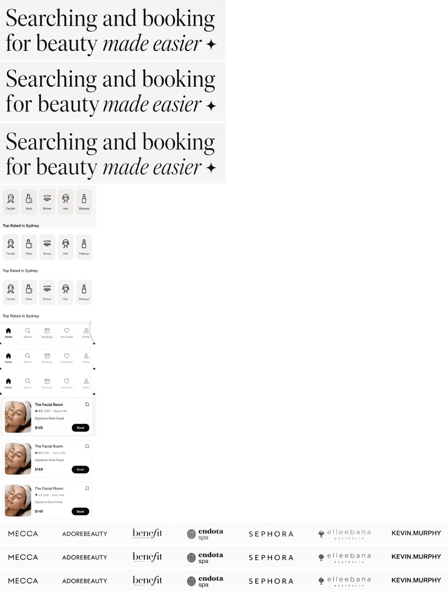
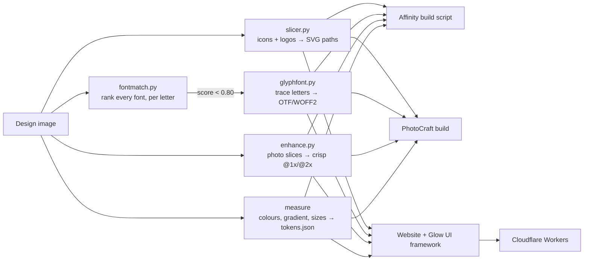

# Glow UI recreation: pixel-perfect design rebuilds with Affinity, PhotoCraft and Claude

A one-to-one recreation of a landing-page design (the **Glow** beauty marketplace), built twice: once in **Affinity** and once in **PhotoCraft**, both driven by Claude through their MCP servers. It's then turned into a responsive website and a reusable UI framework, deployed on Cloudflare Workers.

This repo has everything: the tools that made the recreations accurate, the editor build scripts and files, the website, the design system, and a playbook for getting recreations right.

| | Live |
|---|---|
| **PhotoCraft version:** site, design notes, framework | [site](https://glow-photocraft.i-quietus.workers.dev) · [**/design**](https://glow-photocraft.i-quietus.workers.dev/design) · [/framework](https://glow-photocraft.i-quietus.workers.dev/framework) |
| **Affinity version:** site, design notes, framework | [site](https://glow-affinity.i-quietus.workers.dev) · [**/design**](https://glow-affinity.i-quietus.workers.dev/design) · [/framework](https://glow-affinity.i-quietus.workers.dev/framework) |

The `/design` pages have drag-to-compare sliders (original vs. v2, and v1 vs. v2) and a side-by-side table of the two editors' runs.


---

## Contents

1. [Results](#results)
2. [What made the recreations accurate](#what-made-the-recreations-accurate): the fixes
3. [The pipeline](#the-pipeline)
4. [Tools](#tools): slicer, font finder, custom font builder, photo enhancer
5. [Affinity guide](#affinity-guide)
6. [PhotoCraft guide](#photocraft-guide)
7. [Glow UI framework](#glow-ui-framework)
8. [Website and deployment](#website-and-deployment)
9. [Affinity vs. PhotoCraft: token usage](#affinity-vs-photocraft-token-usage)
10. [Checklist for a perfect 1:1 recreation](#checklist-for-a-perfect-11-recreation)
11. [Known limits and ideas](#known-limits-and-ideas)
12. [Repo layout](#repo-layout) · [Credits and licences](#credits-and-licences)

---

## Results

**v2** is the current version. It uses traced icons and logos, a custom font traced from the design, AI-upscaled photos and shared design tokens. **v1** was the first pass, with hand-drawn icons, one flat logo strip and lookalike fonts.

| Affinity v2 | PhotoCraft v2 |
|---|---|
|  |  |

Detail crops, in three rows each: original, Affinity v2, PhotoCraft v2.



What changed from v1 to v2, using the phone's service icons as the example (rows: original, v1 hand-drawn, v2 traced):


The website, on desktop (scaled 1:1 with the design) and mobile:

| Desktop | Mobile |
|---|---|
|  |  |

---

## What made the recreations accurate

These are the problems we hit in v1 and the fix for each. The fixes apply equally to Affinity and PhotoCraft.

| Problem in v1 | Fix in v2 | Tool |
|---|---|---|
| **Small icons redrawn by hand** looked roughly right but not the same: wrong stroke weight and wrong details (the Facials icon was an oval). | **Trace every icon from the design** with potrace at 8× after removing the background. The result is an exact vector shape in absolute design coordinates, used directly by the editors and the website. | [`tools/slicer.py`](tools/slicer.py) |
| **Brand logos were one flat image strip**, so they couldn't be moved, recoloured or reflowed on mobile. | **Auto-split the strip into one component per logo** at gaps of ≥ 30 empty columns, then trace each one to SVG. | `slicer.py` (`"split": true`) |
| **Faint, thin strokes vanished** (logo taglines, thin icon lines). | **A per-item ink threshold** (`"threshold": 0.28–0.35` for fine detail, 0.5 by default). | `slicer.py` |
| **Fonts were guessed by eye.** Bodoni 72 / Libre Caslon looked close but differed in letter widths and shapes. | **Measure it.** Render the same text in every Google Fonts family plus every installed font, then score **per letter** (line split into glyphs, each letter scaled the same way and compared by IoU). Whole-line scoring is misleading because spacing drift swamps shape differences. | [`tools/fontmatch.py`](tools/fontmatch.py) |
| **No free font matched the headline** (best per-letter score 0.72, a lookalike rather than a match). | **Build a font from the design itself.** Split the headline into letters, trace each one, take spacing from the measured gaps, and write an OpenType font (OTF + WOFF2). "Glow Display" Regular and Italic reproduce the headline exactly. | [`tools/glyphfont.py`](tools/glyphfont.py) |
| **The custom font's "o" carried a sliver of the neighbouring "b".** | Assign **every connected ink blob to exactly one letter** instead of cutting by bounding box. | `glyphfont.py` |
| **Photo slices were soft** at 1× and blurry on retina screens. | **Real-ESRGAN ×4**, blended 65/35 with a Lanczos upscale (so skin keeps texture), a light unsharp mask, and a **tone lock** that restores the original low-frequency colour so the slice still blends into flat backgrounds. Exported as @1x and -2x. | [`tools/enhance.py`](tools/enhance.py) |
| **A visible seam** where the photo met the page background. | The page background is a measured **vertical gradient** (#EEEEEE → #F6F6F6), not a flat grey. Sample it with 1-pixel rows across the seam. | measured, in `tokens.json` |
| **Colours and sizes drifted** between the editors and the web build. | **One set of design tokens** (`framework/tokens.json`), read by the website CSS and both editor builds. | [`framework/`](framework/) |
| Text sat about 0.2 em too high in Affinity. | Calibrate **first-baseline offsets** per font (frame top = baseline − 0.73 × size for Helvetica Neue, 0.735 for Figtree, 0.75 for Bodoni 72 and Glow Display). | `build_glow_v2.js` |
| Affinity showed every Figtree weight as 300. | Affinity misreads Figtree's variable-weight file. Generate **fixed-weight instances** with `fonttools varLib.instancer` (400/500/600/700) and install those. | see [Fonts](#fonts-in-the-editors) |

### Results of the tools on this design


*Above: each traced component at 4× zoom, original pixels on top and the traced vector below.*


*Above, top to bottom: the original headline; the same words typed in the custom Glow Display font (identical shapes and spacing); an overlay.*


*Above: a plain 1× slice enlarged (left) vs. enhanced (right).*

---

## The pipeline



1. **Measure:** layout boxes, colours (sample rows and columns, not single pixels), text baselines and sizes. Put them in `framework/tokens.json`.
2. **Slice:** photos become raster slices (`sips` or `enhance.py`); icons and logos become traced vectors (`slicer.py`).
3. **Fonts:** run `fontmatch.py` per text style. If the best score is under 0.80, build the font with `glyphfont.py`.
4. **Build:** Affinity uses a pasted JavaScript build script; PhotoCraft uses batched commands plus an SVG import. Both read the same manifest and tokens.
5. **Verify:** export, then compare zoomed crops against the original (stack crops vertically and view them). Fix, re-run, repeat.
6. **Ship:** the website uses the same components, tokens and fonts. `npm run deploy:*` publishes it.

---

## Tools

One-time setup on macOS (potrace, a Python env, Real-ESRGAN):

```bash
tools/setup.sh
```

### `slicer.py`: icons and logos to exact vectors

```bash
tools/.venv/bin/python tools/slicer.py design.jpg tools/glow_spec.json variants/shared/components
```

The spec is a list of rough boxes. The tool tightens each box to the ink, so rough boxes are fine:

```json
[
  {"name": "feat_search", "box": [100, 680, 40, 40]},
  {"name": "tile_brows",  "box": [1214, 408, 36, 40], "threshold": 0.35},
  {"name": "logo", "box": [100, 945, 1340, 60], "split": true, "min_gap": 30, "threshold": 0.28,
   "names": ["logo_mecca", "logo_adorebeauty", "logo_benefit", "logo_endota", "logo_sephora", "logo_elleebana", "logo_kevinmurphy"]}
]
```

For each component it writes:
- a transparent PNG (ink colour, alpha = ink strength);
- an SVG (local coordinates, for the web);
- a `manifest.json` entry with `box`, `colour`, `d` (SVG path) and `paths` (absolute M/L/C/Z segments in design pixels, for the editors).

**How it works:**
- The background colour is the median of the border pixels.
- Ink = colour distance from the background, normalised to the 99.5th percentile.
- It upscales 8× with Lanczos, thresholds, and traces with `potrace --alphamax 1 --opttolerance 0.2 --turdsize 4`.
- Holes come out as reversed subpaths, so both nonzero and even-odd fills work.

### `fontmatch.py`: find the font, one to one

```bash
tools/.venv/bin/python tools/fontmatch.py design.jpg --box 50 240 650 90 \
    --text "Searching and booking" --category serif --top 10 --out fonts/headline_roman.json
```

**Candidates:**
- Every Google Fonts family in the category, from the public metadata endpoint.
- Each family is downloaded as a TrueType subset of just the sample text, so it's a few KB.
- Every font installed in `/System/Library/Fonts`, `/Library/Fonts` and `~/Library/Fonts`, keeping only those that cover the sample characters.

**Scoring** (mean per-letter IoU):
1. The design line is upscaled 3× and split into letters (connected components; touching italic letters are split at the thinnest column).
2. Each candidate letter is scaled by the factor that matches line heights.
3. Its shape is compared, centred, with the original letter.

**Output:** a ranking with the font size and letter-spacing that reproduce the line, a JSON report, and an overlay sheet (grey = match, red/black = mismatch).

| Score | Verdict |
|---|---|
| ≥ 0.80 | near-exact match: use it |
| 0.70–0.80 | close lookalike |
| < 0.70 | probably a commercial or custom font: run `glyphfont.py` |

On this design:

| Text | Best result | Decision |
|---|---|---|
| Headline serif | 0.72 (Times-like faces; the original is probably a commercial display face) | custom **Glow Display** |
| Body sans | Mingzat, Fustat, **Figtree**, Host Grotesk and Google Sans Flex within 0.02 of each other at 18px | **Figtree**: its line width is identical to the original at the matched size |

> Small text (under about 20px) can't separate close candidates well. Break ties visually by rendering the candidates under the original line (see `fonts/` for the comparison approach), and prefer the one whose line width matches.

### `glyphfont.py`: make the font when none matches

```bash
tools/.venv/bin/python tools/glyphfont.py design.jpg fonts/glow_display.json fonts/out
```

```json
{"family": "Glow Display", "style": "Regular", "italic": false,
 "lines": [{"box": [52, 248, 644, 82], "text": "Searching and booking"},
           {"box": [52, 326, 290, 78], "text": "for beauty"}]}
```

**Steps:**
1. Split each line into letters, assigning every ink blob to exactly one letter.
2. Measure the baseline (median bottom of letters without descenders).
3. Estimate the em size from ascender height ÷ 0.72.
4. Trace each letter.
5. Set side bearings from the measured gaps, and the space width from word gaps.
6. Write a CFF OpenType font with `fontTools.fontBuilder`, plus WOFF2 and a JSON report.

**Using the result:**
- The report includes `font_size_px`, the size that reproduces the design (73.4px here).
- The font only contains the letters in the samples. List a lookalike after it in your font stack (`"Glow Display", "Libre Caslon Display", serif`).
- Text whose letters aren't covered should use the lookalike directly. Mixing fonts inside one word looks wrong; that's why the wordmark is a traced logo rather than text.
- More samples at the same size give more letters. Lines at different sizes need separate runs.

### `enhance.py`: crisp photo slices

```bash
tools/.venv/bin/python tools/enhance.py variants/affinity/assets/hero.jpg variants/affinity/assets/hero_hd
# writes hero_hd.jpg (1x) and hero_hd-2x.jpg
```

**Steps:**
1. Real-ESRGAN `realesrgan-x4plus`.
2. Downscale to 2×.
3. Blend 65% AI with 35% Lanczos; pure AI looks airbrushed.
4. Apply an unsharp mask (radius 1.2, 40%).
5. Tone lock: `result + blur(original) − blur(result)` with a 6px Gaussian. This keeps the new detail but the original's colour and brightness, so slices don't show seams.

Use `--blend` to tune it. Lower means more natural texture; higher means sharper.

---

## Affinity guide

**How it connects:**
- The Affinity app runs its own MCP server at `http://localhost:6767/sse`.
- Claude writes JavaScript against Affinity's SDK and runs it with `execute_script`.
- Always read the `preamble` topic first; the server enforces this and also returns saved hints in it.

**Hard limits** (built into Affinity; your Claude config can't change them):
- **Files:** only `~/Desktop` (`app.userDesktopPath`). Put inputs in a Desktop folder.
- **No `eval` / `new Function`:** a script on disk can't be loaded and run, so paste the whole script into `execute_script`. Reading data with `File.readAll(path).toString()` plus `JSON.parse` works, which keeps scripts small: the 37 traced components come from a 330 KB JSON file instead of the script.
- **Fonts:** Affinity loads its font list at startup. After installing fonts, restart Affinity (with no unsaved documents). It may pick up some new fonts dynamically, but cached fonts don't update until a restart.
- **Output:** `console.log` is the only way to get data back. Check visually with `render_spread` or by exporting a PNG and reading it.

**Build scripts:**
- [`editors/affinity/build_glow_v1.js`](editors/affinity/build_glow_v1.js): v1, with hand-drawn icons.
- [`editors/affinity/build_glow_v2.js`](editors/affinity/build_glow_v2.js): v2. It reads the manifest and tokens, builds every traced icon and logo as a filled `PolyCurveNode`, sets the headline in Glow Display (falling back to traced outlines if the font is missing), and places the 2× photos at 0.5 scale so a 2× export stays crisp.

**SDK patterns that work.** All of these are saved as Affinity SDK hints, so future sessions see them in the preamble:

```js
// document in pixels
const o = NewDocumentOptions.createDefault(); o.units = UnitType.Pixel; o.dpi = 72; o.width = 1536; o.height = 1024;
const doc = Document.createFromOptions(o);

// rounded rectangle (setting only the radius silently does nothing)
const s = ShapeRectangle.create(); s.setAbsoluteSizes(true, w, h);
for (const c of [s.topLeft, s.topRight, s.bottomLeft, s.bottomRight]) { c.cornerType = ShapeCornerType.Round; c.setRadius(r, w, h); }
doc.addNode(ShapeNodeDefinition.create(s, new Rectangle(x, y, w, h), FillDescriptor.createSolid(RGBA8(0,0,0,255)), null, null, null));

// traced path → filled vector node
const b = CurveBuilder.create(); b.beginXY(x, y); b.addBezierXY(c1x, c1y, c2x, c2y, x2, y2); b.close();
const poly = PolyCurve.create(); poly.addCurve(b.createCurve());
doc.addNode(PolyCurveNodeDefinition.create(poly, fill, FillDescriptor.createNone(), LineStyleDescriptor.create(LineStyle.create({weight: 0})), FillDescriptor.createNone()));

// 2x image at half scale (crisp 2x export); A.multiply(B) applies B first
im.transform = Transform.createTranslate(x, y).multiply(Transform.createScale(0.5, 0.5));
```

- **Groups:** add a `ContainerNodeDefinition`, then `doc.addNode(def, doc.layers.first)`. New nodes go on top.
- **Gradients:** `Gradient.create(stops)` → `GradientFill.create(grad, GradientFillType.Linear)` → `FillDescriptor.create(fill, false, transform, BlendMode.Normal, false)`. The transform maps a unit segment along +x.
- **Rotated text (badge arc):** build each letter's frame around the origin, then `new TransformBuilder().rotate(θ).translateXY(x, y).transform`.
- **Saving helpers:** the script library holds a "UI recreation helpers" starter. Read it before a new build instead of rediscovering the APIs.

---

## PhotoCraft guide

**How it connects:**
- `photocraft-cli mcp` runs a headless engine over stdio.
- Edits go through `command_run` / `command_batch`, with documents handled by `doc_*`.

**Setup.** File access is limited to the folders passed at launch:

```bash
claude mcp add photocraft -s user -- photocraft-cli mcp \
  --automation-read-root ~/Design --automation-write-root ~/Design
```

Use a dedicated folder: the roots are the only fence on what an agent can read and overwrite. Reconnect with `/mcp` after changing them. A server started before you install fonts won't see them.

**Disabled in automation, by design:**
- **Save for Web** (slice export) and **Place Embedded / Place Linked.** These take paths from file dialogs, which would get around the root fence.
- **Workaround for slicing:** crop → `doc_export` → undo.
- **Workaround for placing images:** `doc_open` the image, `select.all` + `edit.copy`, `doc_select` the target, then `edit.paste {center:[cx,cy]}`.

**Tips from the v2 run** (tested):
- **Paths: go through SVG.** Write one SVG at document size with one `<path id="name" fill="#hex" d="…">` per element, in absolute coordinates. `doc_open` gives one named shape layer per path, keeping fills and holes. In that document run `select.allLayers` → `layer.groupLayers` → `edit.copy`, then `edit.pasteSpecial.pasteInPlace` in the target. Without the group, only the active layer is copied. [`editors/photocraft/v2_traced.svg`](editors/photocraft/v2_traced.svg) is the file used here.
- **Inline paths are expensive.** `shape.create {kind:"path", path:{subpaths:[{knots}]}}` works, but the knots JSON is about 2× the size of SVG `d` strings, and every `shape.create`, `shape.edit` and `shape.info` reply echoes the whole path back. This was the main token cost of v1.
- **Half-pixel image centres work:** center `[1144, 591.5]` on a 97px-tall image lands at y = 543. The paste result reports `offset`, so you can check placement without re-inspecting.
- **Fonts:** check with `type.fonts {"family":"Name"}`. An empty `faces` list means the font isn't loaded. **Never** call `type.fonts` without a family; it returns about 195k characters.
- **Batching:**
  - `command_batch` handles dozens of `layer.delete`, `layer.hideLayers`, `layer.renameLayer` or `layer.select` steps cheaply.
  - It stops at the first error and reports how many steps completed.
  - It can't switch documents; call `doc_select` between batches.
- **Small fixes:**
  - `layer.duplicate` followed by `shape.edit {move:[dx,dy], name}` duplicates and repositions a shape.
  - `type.setStyle {range:[0,1], color:[0,0,0,0]}` hides one glyph without reflowing the text.
- **Verbose output to avoid:**
  - `doc_inspect` on a document with 100+ layers returns about 25k characters each call; note layer ids once and reuse them.
  - Broad `command_list` filters: `"type."` returns about 10k characters. Use specific filters.
  - `doc_close` and `doc_select` return the whole session list.
- **Pitfalls:**
  - `doc_open` on a file that's already open gives a new index; always use the index it returns.
  - Closing documents renumbers higher indices, so close from the highest down.
  - The PNG export warns "layers flattened"; that's expected.
- **Checking the result:** stack original and render crops vertically (ImageMagick `-append`, or Pillow) and view them. This is cheaper and sharper than `render_preview`.

---

## Glow UI framework

A design system measured from the photo, so new pages built from it look like the original. See it live at [/framework](https://glow-affinity.i-quietus.workers.dev/framework).


| File | What it is |
|---|---|
| [`framework/tokens.json`](framework/tokens.json) | Design tokens in W3C format: 16 colours, 3 font stacks, 13 type styles, radii, sizes, spacing, shadows. The website and both editor builds read it. |
| [`framework/glow.css`](framework/glow.css) | CSS variables (`--gl-*`), `@font-face` for Glow Display, type classes, and components: `gl-btn`, `gl-pill`, `gl-search`, `gl-feature`/`gl-ring`, `gl-card`, `gl-tile`, `gl-tabbar`, `gl-badge`, `gl-device`, `gl-logos`. All flow-layout and responsive. |
| `framework/icons.svg` (generated) | One `<symbol id="gl-NAME">` per traced icon. The fill follows CSS `color`. |
| `framework/fonts/` (generated) | Glow Display Regular/Italic as WOFF2 and OTF. |

Usage:

```html
<link rel="stylesheet" href="framework/glow.css">
<a class="gl-btn" href="#">Sign Up / Log In</a>
<span class="gl-ring"><svg class="gl-icon" style="width:29px;height:31px"><use href="framework/icons.svg#gl-feat_search"/></svg></span>
```

**Design rules from the measurements:**
- **Colour:** near-black ink (#111) on a soft grey gradient. Every control is either white with a 1px #E8E8E8 border, or near-black (#0B0B0B) with white text.
- **Radius:** pill-round for controls, 26px for the hero search bar, 10px for cards and tiles.
- **Type:** high-contrast serif display (Glow Display) for headlines and the badge numeral only; Figtree for everything else. Eyebrows are 13px uppercase with 0.3 em letter-spacing.
- **Icons:** 1.5–1.7px line icons, about 20px in controls and 30px in feature rings.

---

## Website and deployment

The site is static HTML and CSS: [`src/index.html`](src/index.html) and [`src/styles.css`](src/styles.css).

- **Desktop (≥ 1024px):** every measurement is `calc(N * var(--u))`, where `--u = 100cqw / 1536` (a container-query unit), so the page is 1:1 with the design at any desktop width.
- **Phone mockup:** scales with its own container (`--v = 100cqw / 824`).
- **Below 1024px:** a stacked mobile layout.
- **Icons:** traced icons are sized from their measured dimensions (`style="--w:29;--h:31"`, with `--k` as the unit of the current layout).

```bash
npm install
npm run build                    # dist/affinity and dist/photocraft
CLOUDFLARE_ACCOUNT_ID=<your account id> \
AFFINITY_URL=https://glow-affinity.<sub>.workers.dev PHOTOCRAFT_URL=https://glow-photocraft.<sub>.workers.dev \
  npm run deploy:affinity && npm run deploy:photocraft
```

Each variant is a Workers static-assets site (`wrangler.<variant>.jsonc`) containing the live page, `/design` (comparison sliders and stats) and `/framework`, with a custom 404 page.

---

## Affinity vs. PhotoCraft: token usage

| | Affinity | PhotoCraft |
|---|---|---|
| **v1** run order | First, with no prior knowledge | Second, given the measurements from the Affinity run |
| **v1** tokens (context) | ≈ 174k (≈ 135k excluding session overhead) | ≈ 146k |
| **v1** tool calls | ≈ 82 | 58 |
| **v1** main cost | Learning the SDK (docs, experiments) | Shape commands echoing full path data |
| **v2** upgrade tool calls | ≈ 10 (2 build runs + checks) | 81 |
| **v2** upgrade tokens | ≈ 25k | ≈ 151k (two 133-layer `doc_inspect` dumps ≈ 50k) |
| **v2** headline | Live text in Glow Display | Traced outlines (server started before the font was installed) |
| Editable layers (v1) | 164 in 8 groups | 133 |

**Takeaways:**
- **Output quality is a tie.** Both reach about 1px alignment once they use the same traced assets.
- **Affinity is cheaper to iterate.** A script is reusable, reads data files, and a rebuild is one call.
- **PhotoCraft is cheaper per edit** for small changes, but costly for large vector imports unless you go through SVG.
- **The shared tools did most of the work.** Once icons, fonts and photos are prepared outside the editor, either editor only has to place them.

Token figures come from the context counter, not a billing meter. The runs weren't like-for-like (see "run order").

---

## Checklist for a perfect 1:1 recreation

**Measure first**
- [ ] Get the design at its native resolution. Note the canvas size and work in its pixel units (1 design px = 1 unit everywhere).
- [ ] Sample colours with 1-pixel **rows and columns**, not single points. Look for gradients behind photos.
- [ ] Measure text by **baseline** (median bottom of letters without descenders), not by bounding box.
- [ ] Record every box: [x, y, w, h] for controls, icons, photos and text lines.

**Raster vs. vector**
- [ ] Photos → raster slices. Crop with a few pixels of margin, and make sure no text or UI pixels are baked in. If they are, clip or mask them.
- [ ] Icons, logos, wordmarks → **traced vectors** (`slicer.py`). Never hand-draw them.
- [ ] Logo strips → `split: true`, one component per brand.
- [ ] Faint details → lower `threshold` until taglines and hairlines survive. Check them on the contact sheet.

**Fonts**
- [ ] Run `fontmatch.py` per text style, using the largest available sample of that style.
- [ ] Score ≥ 0.80: use the font at the reported size and letter-spacing.
- [ ] Display text scoring < 0.80: run `glyphfont.py` and add a lookalike fallback.
- [ ] Small body text: pick among the top candidates by **line width** at the matched size.
- [ ] Install fonts **before** starting the editors' MCP servers or apps. Use fixed-weight instances for Affinity.

**Photos**
- [ ] `enhance.py` every photo slice. Use @2x on the web, and place the 2× image at half scale in vector editors.
- [ ] Keep the tone lock on, so enhanced slices don't seam against flat colours.

**Build**
- [ ] Put tokens in one file, and read it from every build (web and editors).
- [ ] In Affinity, keep the build as one script that reads JSON manifests from the Desktop.
- [ ] In PhotoCraft, batch everything, import vectors as one SVG, and paste the group in place.
- [ ] Name every layer after its source component.

**Verify**
- [ ] Export, then stack zoomed crops (original over recreation) for the nav, headline, controls, icons, cards and footer.
- [ ] Overlay text in a contrasting colour to check baselines and widths.
- [ ] Check the seams where slices meet backgrounds.
- [ ] Iterate until differences are ≤ 1px. Compare v1 and v2 with the sliders on `/design`.

---

## Known limits and ideas

- **Glow Display only has the headline's letters.** Feeding `glyphfont.py` more samples would extend it: the wordmark, "Welcome to Glow" and "1000+" are at different sizes, so this needs per-line size normalisation (a planned feature).
- **Text under about 3px tall** (the benefit "SAN FRANCISCO" tagline) can only trace as a dotted line. Re-type it in a matching font if it matters.
- **Small-text font matching** can't separate close candidates at 1×. Super-resolution before matching might help.
- **PhotoCraft's headline** is outlines in v2 because the server started before the font was installed. Restart the server and swap in live text.
- **Affinity "Medium" weight:** after replacing the variable Figtree, restart Affinity so it drops the cached weights.
- **Ideas:** auto-detect components (no manual boxes), centreline tracing for stroke icons (to get editable strokes instead of filled outlines), and a token exporter for Figma / Tailwind.

---

## Repo layout

```
src/                  website (index.html, styles.css)
framework/            Glow UI: tokens.json, glow.css (+ generated icons.svg, fonts/, logos/)
tools/                slicer.py, fontmatch.py, glyphfont.py, enhance.py, setup.sh, specs
fonts/                font specs, fontmatch reports, out/ = Glow Display OTF + WOFF2
variants/<editor>/    each editor's photo slices (+ _hd enhanced) and v1/v2 renders
variants/shared/      original design, traced components (manifest.json, SVG, PNG), traced headline outlines
editors/affinity/     build_glow_v1.js, build_glow_v2.js, .af files
editors/photocraft/   glow_v1.pcraft, glow_v2.pcraft, v2_traced.svg
build.mjs             builds dist/<editor>: site + /design + /framework
wrangler.*.jsonc      Cloudflare Workers configs
docs/images/          README images
```

---

## Credits and licences

- **Code** in this repo (tools, build scripts, site, framework CSS): MIT, see [LICENSE](LICENSE).
- **Glow Display** (`fonts/out/`) is traced from the Glow design for this recreation. Treat it as part of the design assets, not a general-purpose font.
- **Figtree** (Erik Kennedy) and **Libre Caslon** (Impallari Type) are under the SIL Open Font License. Figtree's fixed-weight instances are generated locally and not committed.
- **[potrace](https://potrace.sourceforge.net/)** (Peter Selinger, GPL) and **[Real-ESRGAN](https://github.com/xinntao/Real-ESRGAN)** (BSD-3) are installed by `tools/setup.sh`, not bundled.
- **The Glow design and its photography** belong to their owner.
- **Brand logos** (MECCA, Adore Beauty, Benefit, Endota Spa, Sephora, Elleebana, Kevin.Murphy) are trademarks of their owners. They appear only to recreate the original mockup and imply no affiliation or endorsement. Remove or replace them before using this design in production.
