# Glow UI recreation: pixel-perfect design rebuilds with Photoshop, PhotoCraft, Affinity and Claude

A one-to-one recreation of a landing-page design (the **Glow** beauty marketplace), rebuilt in **PhotoCraft**, **Photoshop** and **Affinity**, all driven by Claude, and as a responsive **website** with a reusable UI framework, deployed on Cloudflare Workers. The tools and the step-by-step method are packaged as a **replicable system**: one project file per design, so the same pipeline recreates any other site or mockup ([Recreate any design](#recreate-any-design-the-project-system)).

## Latest results

**Perfect (exact mode): 0 pixels different** in Photoshop and PhotoCraft. The original is split into named, editable layers (background plus eight page sections) that rebuild it bit for bit. See [Exact mode](#exact-mode-a-literally-perfect-result).

**Built (redrawn: real shapes, traced vectors, live text underneath), % of pixels changed vs. the original:**

| Tool | Exact mode | Built, standard | Built, max-fidelity | Previous best (standard / max) |
|---|---|---|---|---|
| **PhotoCraft** | **0.000%** (v7) | **0.020%** (v8) | 0.005% (v8) | 0.034 / 0.020 |
| **Photoshop** | **0.000%** (v8) | 0.024% (v9) | **0.004%** (v9) | 0.041 / 0.025 |
| **Website** | — | 0.026% (v8) | 0.006% (v8) | 0.041 / 0.026 |
| Affinity | — | 0.068% (v6) | 0.026% (v6) | 0.163 / 0.079 |

- **Standard:** vectors for everything except tiny details.
- **Max-fidelity:** every traced element (text, icons, logos) as its original-pixel cutout, over the built shapes, photos and background.

The built versions are now within **0.004–0.026%** of the original. That's 40–160 pixels out of 1.57 million, each off by a few levels at an edge, so they're invisible side by side. How: [Built versions near-perfect](#built-versions-near-perfect-photo-edges).

This repo has everything: the tools that made the recreations accurate, the editor build scripts and files, the website, the design system, and a playbook for getting recreations right.

| | Live |
|---|---|
| **PhotoCraft version:** site, design notes, framework | [site](https://glow-photocraft.i-quietus.workers.dev) · [**/design**](https://glow-photocraft.i-quietus.workers.dev/design) · [/framework](https://glow-photocraft.i-quietus.workers.dev/framework) |
| **Affinity version:** site, design notes, framework | [site](https://glow-affinity.i-quietus.workers.dev) · [**/design**](https://glow-affinity.i-quietus.workers.dev/design) · [/framework](https://glow-affinity.i-quietus.workers.dev/framework) |

The `/design` pages have drag-to-compare sliders (original vs. the latest version, and v1 vs. the latest) and a side-by-side table of the editors' runs.

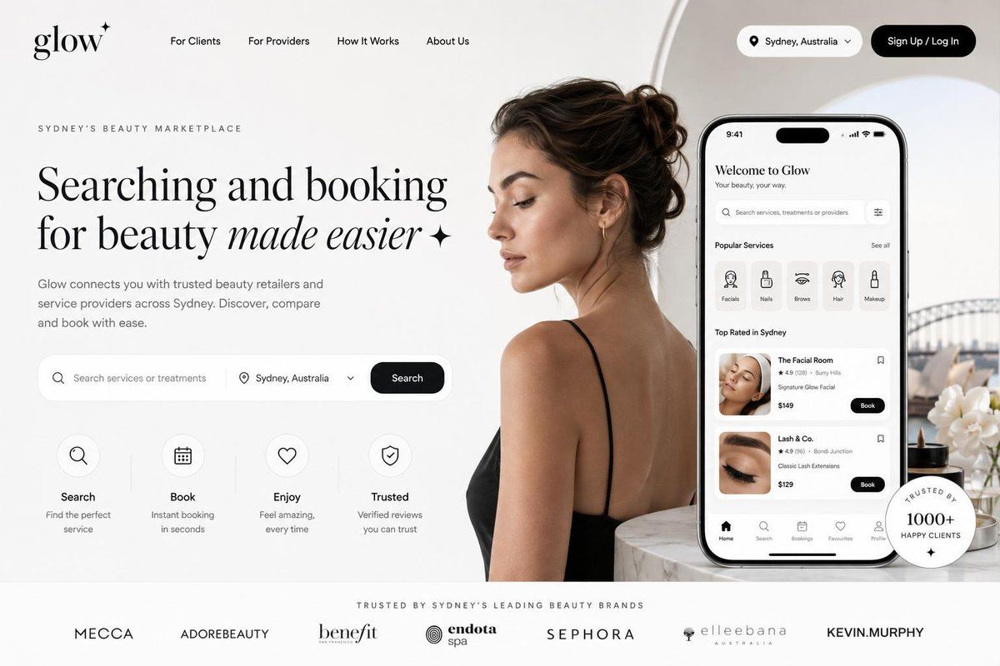

---

## Contents

1. [Results](#results): benchmark, ranking, [built versions near-perfect](#built-versions-near-perfect-photo-edges), [exact mode](#exact-mode-a-literally-perfect-result)
2. [What made the recreations accurate](#what-made-the-recreations-accurate): the fixes, and [lessons from the last 0.1%](#lessons-from-the-last-01)
3. [Recreate any design: the project system](#recreate-any-design-the-project-system): `project.json` + `tools/recreate.py`
4. [The pipeline](#the-pipeline)
5. [Tools](#tools): slicer, font finder, custom font builder, photo enhancer, tuner, shape tuner (squircles, real background), backdrop/plate, kit builder (photo edges), calibration, ink gain, logo parts, clips, rim cleaner, exact layers, orchestrator, benchmark, diff checker
6. [Affinity guide](#affinity-guide) · [Photoshop guide](#photoshop-guide)
7. [PhotoCraft guide](#photocraft-guide)
8. [Glow UI framework](#glow-ui-framework)
9. [Website and deployment](#website-and-deployment)
10. [Affinity vs. PhotoCraft: token usage](#affinity-vs-photocraft-token-usage)
11. [Checklist for a perfect 1:1 recreation](#checklist-for-a-perfect-11-recreation)
12. [Known limits and ideas](#known-limits-and-ideas)
13. [Repo layout](#repo-layout) · [Credits and licences](#credits-and-licences)

---

## Results

**Newest** (PhotoCraft v8, Photoshop v9, website v8): photo edges, the badge cut out of the phone, a clipped badge arc, the wordmark at its exact position, and the shape tuner fitting against the real background (see [below](#built-versions-near-perfect-photo-edges)); plus **exact mode** (PhotoCraft v7, Photoshop v8). **Previous round** (PhotoCraft v6, Photoshop v7, Affinity v6, website v7): the original's own background pixels, shapes calibrated against each tool's real render, per-renderer ink gain, and split-out logo parts. Every tool beat its previous best. **v5**: v4 plus tuned shapes and a max-fidelity mode, rebuilt in four tools (website, Affinity, PhotoCraft, Photoshop) from one kit. **v4** (tuned pixel-exact): everything in v3, plus auto-tuned vectors, original-pixel cutouts for tiny elements, the extracted background and lossless photos. **v3** (pixel-exact): every text block is traced from the original, with the photographed bezel and the measured colours. **v2** It uses traced icons and logos, a custom font traced from the design, AI-upscaled photos and shared design tokens. **v1** was the first pass, with hand-drawn icons, one flat logo strip and lookalike fonts.

| PhotoCraft v8 (0.020%, best standard) | Photoshop v9 (0.024%; 0.004% max, best) | Website v8 (0.026%) | Affinity v6 (0.068%) |
|---|---|---|---|
|  |  |  |  |

<details><summary>v2 renders</summary>

| Affinity v2 | PhotoCraft v2 |
|---|---|
|  | 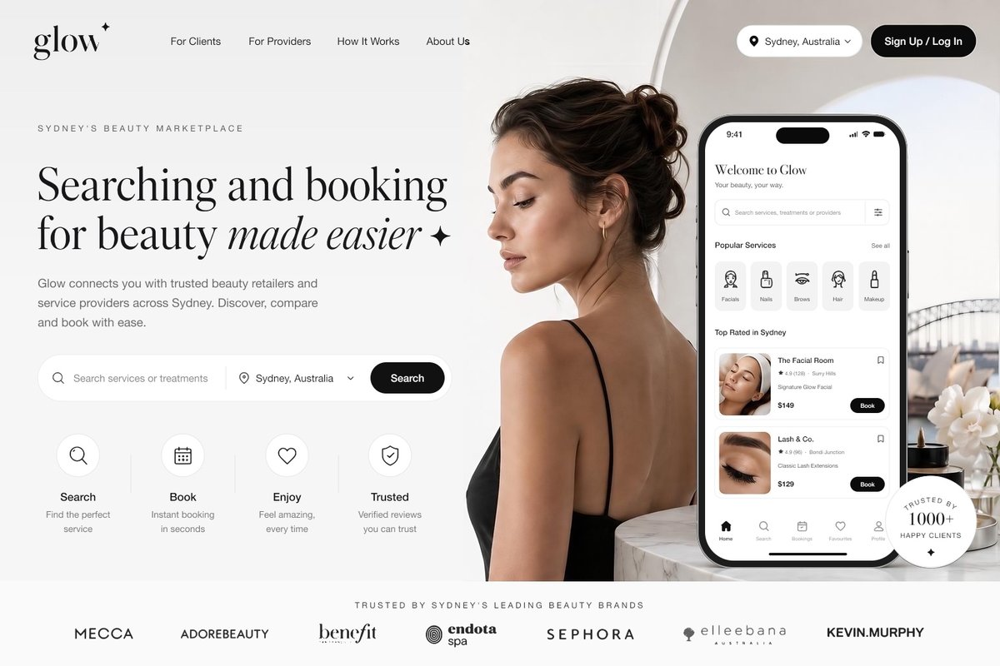 |

</details>

Detail crops, in three rows each: original, Affinity v4, PhotoCraft v4.

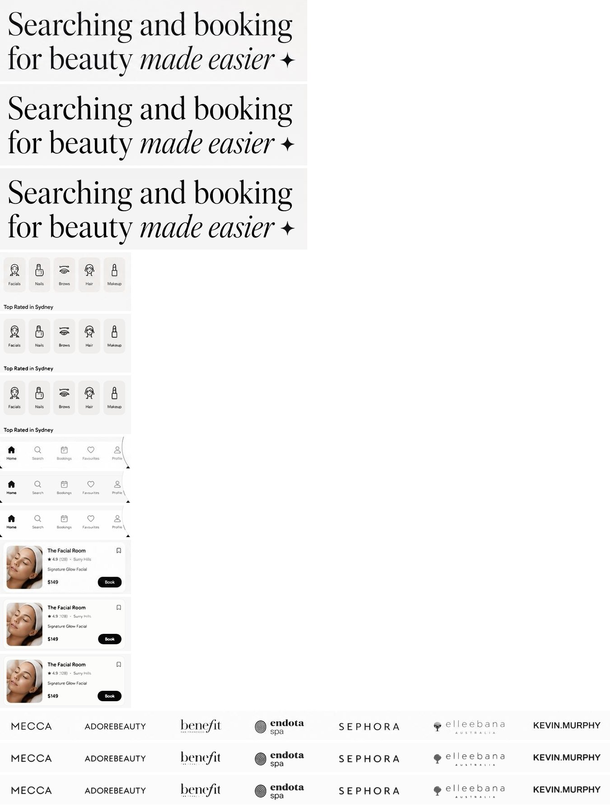

### Measured accuracy

[`tools/diffcheck.py`](tools/diffcheck.py) compares each recreation with the original over 24 named regions (nav, headline lines, intro lines, search bar, phone parts, badge, logos). The figure is the share of pixels that differ by more than 12% after a 0.7px blur, so anti-aliasing noise doesn't count. Lower is better; about 2–2.5% is anti-aliasing plus the small differences between Figtree and the original body font.

| Recreation | v2 | v2, measured corrections | **v3, pixel-exact** | v3 similarity |
|---|---|---|---|---|
| Website (desktop, 1536×1024) | 5.14% | 2.51% | **0.22%** | 0.9948 |
| Affinity | 3.80% | 2.28% | **0.35%** | 0.9941 |
| PhotoCraft | 2.22% | 1.76% | **0.19%** | 0.9946 |

The biggest single fix was the headline's second line on the website: **31% → 2.4%**. It came from adding pair kerning to the custom font plus a measured 5.5px baseline correction.

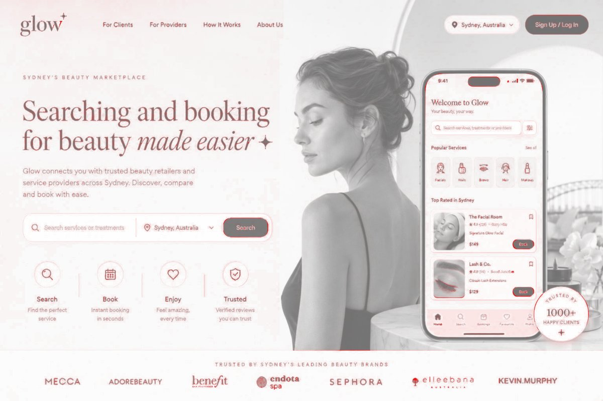

### Benchmark (all versions, four tools)

Generated by [`tools/benchmark.py`](tools/benchmark.py) against the original design (a 1536×1024 JPEG, estimated quality 75). Every export and screenshot it measured is in [`docs/benchmark/`](docs/benchmark/), and the raw numbers are in [`results.json`](docs/benchmark/results.json).

| Version | Changed % | SSIM | ΔE2000 mean | ΔE2000 p95 | PSNR dB |
|---|---|---|---|---|---|
| Floor: original re-saved as JPEG q75 | 0.000 | 0.9997 | 0.025 | 0.200 | 54.90 |
| Floor: original re-saved as JPEG q95 | 0.000 | 0.9995 | 0.087 | 0.639 | 52.96 |
| Affinity v1 | 4.109 | 0.9014 | 2.137 | 4.290 | 19.23 |
| Affinity v2 | 2.284 | 0.9349 | 1.464 | 3.824 | 23.78 |
| Affinity v3 | 0.352 | 0.9774 | 0.675 | 2.167 | 31.54 |
| Affinity v4 | 0.245 | 0.9797 | 0.364 | 1.662 | 32.87 |
| Affinity v5 | 0.163 | 0.9818 | 0.336 | 1.616 | 33.80 |
| Affinity v5 max-fidelity | 0.079 | 0.9847 | 0.213 | 1.080 | 36.59 |
| **Affinity v6** | 0.068 | 0.9864 | 0.296 | 1.603 | 35.46 |
| **Affinity v6 max-fidelity** | 0.026 | 0.9882 | 0.184 | 1.050 | 39.07 |
| PhotoCraft v1 | 4.060 | 0.9028 | 2.178 | 5.044 | 19.10 |
| PhotoCraft v2 | 1.758 | 0.9413 | 1.396 | 4.174 | 24.67 |
| PhotoCraft v3 | 0.193 | 0.9801 | 0.548 | 1.906 | 32.61 |
| PhotoCraft v4 | 0.143 | 0.9815 | 0.356 | 1.754 | 34.12 |
| PhotoCraft v5 | 0.064 | 0.9852 | 0.321 | 1.666 | 36.20 |
| PhotoCraft v5 max-fidelity | 0.032 | 0.9867 | 0.238 | 1.277 | 38.45 |
| PhotoCraft v6 | 0.034 | 0.9873 | 0.265 | 1.461 | 37.29 |
| PhotoCraft v6 max-fidelity | 0.020 | 0.9881 | 0.194 | 1.066 | 39.16 |
| **PhotoCraft v7 exact mode** | 0.000 | 1.0000 | 0.000 | 0.000 | inf |
| **PhotoCraft v8** | 0.020 | 0.9878 | 0.258 | 1.450 | 37.68 |
| **PhotoCraft v8 max-fidelity** | 0.005 | 0.9886 | 0.187 | 1.044 | 39.78 |
| Photoshop v5 | 0.104 | 0.9840 | 0.289 | 1.596 | 35.09 |
| Photoshop v5 max-fidelity | 0.076 | 0.9854 | 0.205 | 1.068 | 36.70 |
| Photoshop v6 | 0.054 | 0.9866 | 0.271 | 1.478 | 36.52 |
| Photoshop v6 max-fidelity | 0.026 | 0.9880 | 0.187 | 1.027 | 38.97 |
| Photoshop v7 | 0.041 | 0.9872 | 0.263 | 1.471 | 36.77 |
| Photoshop v7 max-fidelity | 0.025 | 0.9882 | 0.181 | 1.031 | 39.09 |
| **Photoshop v8 exact mode** | 0.000 | 1.0000 | 0.000 | 0.000 | inf |
| **Photoshop v9** | 0.024 | 0.9877 | 0.255 | 1.450 | 37.28 |
| **Photoshop v9 max-fidelity** | 0.004 | 0.9887 | 0.173 | 1.019 | 39.99 |
| Website v2 | 5.137 | 0.8728 | 2.772 | 8.817 | 18.25 |
| Website v2, measured corrections | 2.514 | 0.9320 | 1.539 | 4.741 | 23.78 |
| Website v3 | 0.217 | 0.9773 | 0.610 | 2.083 | 32.76 |
| Website v4 | 0.141 | 0.9792 | 0.345 | 1.690 | 34.32 |
| Website v5 | 0.115 | 0.9830 | 0.332 | 1.634 | 34.98 |
| Website v5 max-fidelity | 0.077 | 0.9849 | 0.238 | 1.226 | 37.20 |
| Website v6 | 0.108 | 0.9835 | 0.327 | 1.621 | 35.14 |
| Website v6 max-fidelity | 0.070 | 0.9855 | 0.233 | 1.216 | 37.47 |
| Website v7 | 0.041 | 0.9869 | 0.271 | 1.527 | 36.52 |
| Website v7 max-fidelity | 0.026 | 0.9880 | 0.187 | 1.066 | 38.85 |
| **Website v8** | 0.026 | 0.9874 | 0.263 | 1.463 | 36.94 |
| **Website v8 max-fidelity** | 0.006 | 0.9886 | 0.177 | 1.027 | 39.79 |

**Current ranking** (built versions, best of each tool; previous round in brackets):

| Rank | Tool | Standard | Max-fidelity | SSIM (max) | PSNR (max) | Exact mode |
|---|---|---|---|---|---|---|
| 1 | **Photoshop v9** | 0.024% (0.041) | **0.004%** (0.025) | **0.9887** | **39.99 dB** | 0 px (v8) |
| 2 | **PhotoCraft v8** | **0.020%** (0.034) | 0.005% (0.020) | 0.9886 | 39.78 dB | 0 px (v7) |
| 3 | Website v8 | 0.026% (0.041) | 0.006% (0.026) | 0.9886 | 39.79 dB | — |
| 4 | Affinity v6 | 0.068% | 0.026% | 0.9882 | 39.07 dB | — |

Photoshop and PhotoCraft swap places depending on the mode: PhotoCraft's ink-gain strokes make its standard (vector) mode the best, while Photoshop's anti-aliasing makes its max mode the best. Affinity wasn't part of this round. Its v6 build script would take the same kit changes (`--photo-edges 2`, the clipped arc), but it draws shapes from its own script rather than the kit SVG, so the screen and badge geometry would need porting.

All four rebuild the same kit (`tools/make_kit.py`), so the differences come from how each one renders.

**How Photoshop overtook PhotoCraft.** Photoshop v5 scored 0.104%. Comparing it pixel by pixel with PhotoCraft showed that almost all of its extra error was one 1px line: the kit drew the brand strip's divider at y = 893.5, on top of the hero photo's last row. In the original, that boundary is a blend. The photo's bottom edge runs into a faint hairline over rows 893–895 (and the "line" on the left is only 242 against a 246 background). PhotoCraft happened to stack that line below the photo. v6 ships those four rows as original pixels (`strip_edge.png`) instead of drawing a line, and Photoshop now leads on every metric.

**How the website caught up** (0.108% → 0.041%). The old open item was nested shapes inside the phone inheriting their parent's offset. The website now draws every shape from the same `framework/shapes_tuned.svg` the editors use, as one overlay at exact design coordinates; the CSS shapes stay for layout but are transparent in pixel mode. That SVG is calibrated against Chrome's own render (`tools/calibration_website.json`). Calibrating the CSS shapes directly failed for the original reason, nesting.

**How to read it:**
- **Changed %:** pixels off by more than 12% after a 0.7px blur (the `diffcheck.py` measure). Lower is better.
- **SSIM:** structural similarity, where 1.0 means identical.
- **ΔE2000:** perceptual colour difference. Under 1 is invisible; 1–2 is only visible to a trained eye side by side.
- **PSNR:** peak signal-to-noise ratio, in dB. Higher is closer.

**What the floor shows.** Re-saving the original JPEG at its own quality changes essentially nothing (0% changed, SSIM 0.9997, ΔE 0.025). So JPEG noise is not what limits the rebuilds. The remaining gap (SSIM ≈ 0.98 against 0.9997) is real recreation difference, but it's sub-perceptual on average (ΔE ≈ 0.35).

**Where the last bit is** (website v4, share of the remaining SSIM loss):

| Area | Share |
|---|---|
| Edges of traced vector shapes (text over 15px, icons, logos) | 38% |
| Drawn shapes in the photo and phone area (screen, cards, tiles, badge) | 29% |
| Everything else (shapes, backdrop) | 27% |
| Original-pixel cutouts | 6% |

What's left is how a renderer anti-aliases a clean vector edge, compared with how the original's renderer did.

**Prediction vs result.** Before v4 I estimated 0.05–0.1% changed. v4 reached **0.14% (website), 0.14% (PhotoCraft) and 0.25% (Affinity)**: a 35–55% reduction from v3 and 3× lower colour error than v2. That's short of the estimate. The vector edges are the limit: tuning thresholds, offsets and colours removed 17–37% of their error, and only cutting them out as pixels removes the rest.

#### Built versions near-perfect: photo edges

The goal for this round was to get the **built** versions (real shapes and vectors, not the original's pixels) as close to exact mode as possible. Each tool's remaining error was mapped to the element it came from (`where` analysis: changed pixels attributed to each element's and shape's box). Almost all of it was in four places:

| Where (website v7, max mode, 411 px) | px | Cause |
|---|---|---|
| Phone screen outline | 109 | The screen's edge in the photo is physical: a 1px glass highlight along the top, none on the sides, and Apple's smooth corners. No flat fill + outline reproduces it. |
| Trusted badge rim (+ the arc text box over it) | 181 | The badge's grey rim is shaded where it overlaps the phone and the photo. |
| "glow" wordmark | 58 | The page drew the untuned slicer trace in its flex layout instead of the tuned one at its exact box. |
| Cards, island, Book buttons | 49 | Edge anti-aliasing. |

**What worked, in order** (website max mode, % changed):

| Step | Website max | What it is |
|---|---|---|
| v7 | 0.026 | |
| Wordmark in the exact-position overlay, recalibrated | 0.025 | `build.mjs`: `logo_glow` joins the other icons in the pixel overlay (58 → 1 px there). Measured together with a fresh calibration of the website's shapes. |
| **Photo edges** (`make_kit.py --photo-edges 2`) | 0.017 | Shapes that sit directly on the photo (the phone screen, the tab bar's bottom, the badge) are inset 2px with no border, so their outermost edge is the photo's own. Their fills and everything inside them stay built and live. It's the same idea as the photographed bezel the rebuilds have used since v3. |
| **Badge subtracted from the phone** | 0.010 | Where the badge overlaps the phone, the drawn screen covered the photo's badge rim. The badge's disc is now cut out of the screen and tab bar fills, written as plain path geometry (`minus_disc` in `make_kit.py`) because Photoshop's SVG import ignores masks and clip paths. |
| **Badge arc clipped** (`tools/clip_elements.py`) | **0.006** | The "TRUSTED BY" arc's box reached the badge rim, so its trace had 2 rim fragments and its cutout painted the rim in the text colour. Clipping it to the badge's inner circle fixed both. |

The same kit then took **Photoshop to 0.024 / 0.004** and **PhotoCraft to 0.020 / 0.005**.

**Tried and measured, not kept (they're still available as options):**
- **Rim cleaning** (`tools/clean_rims.py`): replace the photo's own edge under each drawn shape with the colour outside it, so each tool's edge blends over clean background. It made the small shapes inside the phone perfect (0 px), but made the screen and badge much worse (website 0.026 → 0.12), because their edges are physical. Applied to the small shapes only, it came out even with v7, so photo edges replaced it.
- **Fitting the screen as a squircle with a glass highlight:** `tune_shapes.py` now supports a `squircle` kind (top and bottom radius plus corner smoothing; iOS-style continuous corners), and `--stroke-widths` fits an inner highlight. The fit was good (edge error 12.9 → 7.5), but the highlight exists on the top edge only, and a uniform border made the sides too bright. Photo edges win here; the squircle kind stays for designs with flat UI screens.
- **Ink gain in Photoshop** (duplicate vector layer at partial opacity): worse. Photoshop's edges already match.

**Shape tuning against the real background.** `tune_shapes.py` used to guess what lies under each shape from its surroundings. That fails for shapes over a photo, as with the badge, whose border colour came out almost white. `--under image` now scores every candidate composited over the actual layer underneath, plus every enclosing shape (a card under its Book button). `--edge-band N` scores only pixels within N px of the outline, for large shapes whose interior holds other content.

#### Exact mode: a literally perfect result

**0.000%.** A redraw can't reach exactly zero: every renderer anti-aliases edges its own way, so the rebuilds level off around 0.02–0.04%. Exact mode is a different deliverable. [`tools/exact_layers.py`](tools/exact_layers.py) splits the original into a background layer (the plate) and eight section layers: Navigation, Hero copy, Search bar, Features, Hero photo, Phone, Badge and Brand strip. Each section layer is the original's own pixels over that section's foreground, opaque, with no overlaps, so the stack composites back to the original bit for bit. Hiding a section leaves clean background behind it. The redrawn vector version sits underneath in the same file, one visibility toggle away. Its scores are the ones in the tables above, and those measure recreation quality; exact mode scores zero by construction.

| Exact mode | Differing pixels | Max channel diff | Changed % | SSIM | PSNR |
|---|---|---|---|---|---|
| Photoshop v8/v9 ([`exact.jsx`](editors/photoshop/exact.jsx), `glow_ps_v8.psd` over the v7 rebuild, `glow_ps_v9.psd` over the v9 rebuild) | **0** | 0 | 0.000 | 1.0000 | ∞ |
| PhotoCraft v7/v8 (`glow_v7.pcraft`, `glow_v8.pcraft`: the 9 PNGs in a top group, placed at 0,0) | **0** | 0 | 0.000 | 1.0000 | ∞ |

```bash
tools/.venv/bin/python tools/exact_layers.py variants/shared/original.jpg framework/backdrop_plate.webp ~/Downloads/glow_v5_kit/exact
# Photoshop: build_v7.jsx, export_v7.jsx, then exact.jsx (adds the group on top, exports, saves glow_ps_v9.psd)
# or, for any project: tools/recreate.py <name> exact
```

**What the latest round added** (each step measured on its own; standard mode):

| Step | Photoshop | PhotoCraft | Website | Affinity |
|---|---|---|---|---|
| Previous best | 0.054 | 0.064 | 0.108 | 0.163 |
| Background plate (`backdrop.py --plate`), strip edge, cleaned hero; website SVG shapes overlay | 0.052 | 0.052 | 0.072 | 0.113 |
| Shapes calibrated against the tool's own render (`calibrate.py`) | 0.052 | — | 0.065 | 0.110 |
| Ink gain (`inkgain.py`) | no gain | 0.044 | 0.052 | 0.079 |
| Logo parts (`split_parts.py`) | **0.041** | **0.034** | **0.041** | **0.068** |

- **Background plate:** the original's own background pixels wherever nothing is drawn (about 30% of the canvas), so even its JPEG grain matches. Under the foreground it falls back to the smooth backdrop.
- **Calibration:** two or three rounds per tool, measured on the max-fidelity render so only the shapes differ. It helped the website and Affinity most. Photoshop's max mode went from 0.026% to 0.025%.
- **Tried and rejected:**
  - A soft grey ring drawn around the badge: much worse.
  - Re-tuning the phone screen shape: its top edge moved up by 1/8px and that hurt.
  - Supersampled export in Affinity: its only dpi-controlled export writes a PDF.
  - Ink gain in Photoshop: its SVG import ignores sub-pixel strokes, and a duplicate vector layer at partial opacity made it worse.
- **Where the rest is:** in standard mode, mostly the benefit wordmark's hairline serifs (thinner than the trace can hold at 1×), then the edges of the large headline and logo vectors. In max mode, the edges of drawn shapes.

**What v6 added:**
- **Strip edge as original pixels:** rows 892–895 ship as `strip_edge.png` (on the web, a 4px overlay; the strip keeps its 1px border, made transparent, so nothing inside shifts). This took Photoshop from 0.104% to 0.054%.
- **Photoshop v6:** [`editors/photoshop/build_v6.jsx`](editors/photoshop/build_v6.jsx) and `export_v6.jsx`, plus `glow_ps_v6.psd`.
- **The Adobe MCP connector, tested.** Signed in through `/mcp` ("claude.ai Adobe"). It's a cloud service (Express, Firefly, Photoshop/Illustrator-style operations on uploaded files), not the Photoshop app on your Mac, so it can't build a layered document. Its relevant tool is `image_vectorize`, tested against our tracer on the brand-logo strip (uploaded at 4×, same treatment as potrace):

  | Logo strip vs original | Mean abs error | Changed % |
  |---|---|---|
  | Adobe `image_vectorize` (211 paths) | 3.56 | 0.62% |
  | Ours: `slicer.py` + `tune.py` (potrace, tuned) | **2.06** | **0.47%** |

  Adobe's tracer keeps more micro-detail (benefit's 3px "SAN FRANCISCO" tagline survives). It loses overall because it repaints the strip background in a slightly different colour and simplifies the endota spiral. Our tuned tracer stays the default; the cutout layers carry the micro-detail anyway.

**What v5 added:**
- **Shape tuning** ([`tools/tune_shapes.py`](tools/tune_shapes.py)). Every rounded rectangle and circle (22 shapes) was fitted against the original: geometry in steps down to 1/8px by coordinate descent, with fill and border colours solved by least squares. Text, icons, photos and nested shapes are excluded from each score, and a result is only accepted if it beats the measured values. Typical error was roughly halved (Book buttons ≈10 → 4, home indicator 8.4 → 2.3). Real radii came out at 9.75–10.9px instead of 11.5px, and rings at 66.5–67px instead of 66px.
- **Max-fidelity mode.** Every traced element (all 94, not just the tiny ones) is shown as its original-pixel cutout on standard-resolution screens:
  - **website:** on by default (`<html class="pixel max">`); remove `max` to get tuned vectors;
  - **editors:** a hidden group, "Max fidelity: all elements as original pixels".
  - Vectors stay underneath for retina screens and editing.
- **One editor kit** ([`tools/make_kit.py`](tools/make_kit.py)): backdrop, lossless photos, a tuned-shapes SVG, tuned-vector SVGs and the two cutout layers. Any editor can rebuild from it. Photoshop was built purely from the kit.
- **Photoshop**, scripted locally with ExtendScript (see the [Photoshop guide](#photoshop-guide)).

**What v4 added:**
- **Auto-tuning** ([`tools/tune.py`](tools/tune.py)). For every traced element: 7 trace thresholds × 25 sub-pixel offsets (1/8px steps), and the fill colour solved by least squares for each candidate's coverage. Each candidate is scored with a simulated 8×-supersampled render against the original. This cut error by 37% for icons and logos and 31% for text.
- **Original-pixel cutouts for tiny elements:** anything whose shorter side is 15–18px or less (49 elements: tab labels, captions, status icons, the eyebrow, card text) uses the original pixels on standard screens. On retina screens and in the editors the tuned vector is still there (hidden in the editors).
- **The original's real background** ([`tools/backdrop.py`](tools/backdrop.py)). Everything that isn't background is masked, the rest is averaged in 8px cells, and the gaps are filled by diffusion. The result is a 192×128 image (3 KB) that reproduces the 2D shading a gradient can't. This cut the colour error by about a third.
- **Lossless photo slices at 1×** (WebP lossless on the web, PNG in the editors), so the photos add no new compression noise.
- **Fixed slice boxes.** A check for ink touching a box edge found 9 clipped text blocks: descenders on "Enjoy", "every time", "you can trust" and "your way", plus "Bondi Junction". It also found the Profile label picking up the badge ring.

### Pixel-exact mode (v3): how close to 100%?

Literally 100% (zero differing pixels) is only possible by showing the original image itself:
- **Edges:** any rebuild from editable parts anti-aliases its edges a little differently.
- **JPEG noise:** the original is a JPEG, so it carries compression noise that a clean render never reproduces.

v3 gets as close as an editable rebuild can, 0.19–0.35% of pixels. What's left is edge smoothing on tiny details: the 12px status-bar icons, logo taglines and badge lettering. Side by side, it can't be seen.

**What v3 changed.** A breakdown showed that about 85% of the remaining v2 mismatch was text drawn in a font that wasn't quite the original, and most of the rest was the phone bezel and photos.

1. **Every text block traced from the original.** `tools/text_all_spec.json` lists 55 blocks; the slicer traces each one, and outlines are drawn on top. The live text stays:
   - **website:** in the page, transparent on desktop (still selectable, read by screen readers and search engines), and the normal live text on mobile, where it reflows;
   - **editors:** as hidden layers, ready to edit.
2. **Icons and logos at exact design coordinates** (website). In flex layouts they sat 0.5–1px off; the overlay places them at their measured boxes.
3. **The photographed phone bezel.** The hero slice already contains the real bezel, so the drawn frame was removed and only the screen is drawn, with its measured colour (#F7F7F7), bottom edge and 44px bottom radius.
4. **The tab bar is a separate, whiter strip.** It's #FEFEFE under a #F7F7F7 screen; the PhotoCraft run spotted this.
5. **Measured surface colours.** The original has three different blacks (#000001 Sign Up, #111214 Search, #060606 Book) and several near-whites (#FEFEFE, #FCFCFB, #FBFBFB, #F7F7F7, #EFEDEB tiles). They're all in `tokens.json`.
6. **Original pixels at 1×.** On standard screens the page shows the untouched photo slices; retina screens get the AI-enhanced 2× versions. In the editors the enhanced photos are kept as hidden alternate layers for 2× export.
7. **Stroke-core colour for traced elements.** Colour comes from the most-inked 20% of pixels; averaging all ink pixels made small grey text too light.

The trade-off: in pixel-exact mode the visible desktop text is outlines, not live type. On the website, remove `class="pixel"` from `<html>` to go back to live text. In the editors, show the hidden text layers and hide the "Pixel-exact text" group.

What changed from v1 to v2, using the phone's service icons as the example (rows: original, v1 hand-drawn, v2 traced):

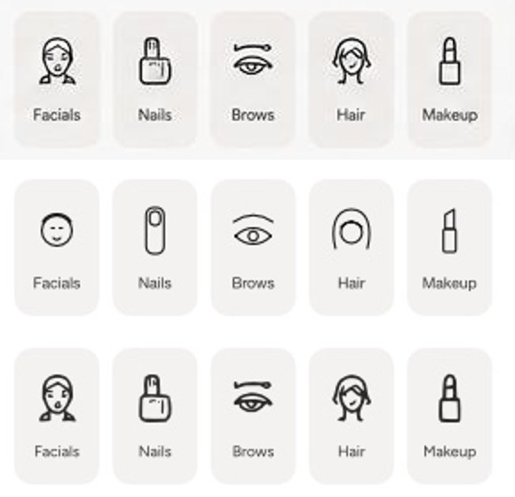

The website, on desktop (scaled 1:1 with the design) and mobile:

| Desktop | Mobile |
|---|---|
|  | 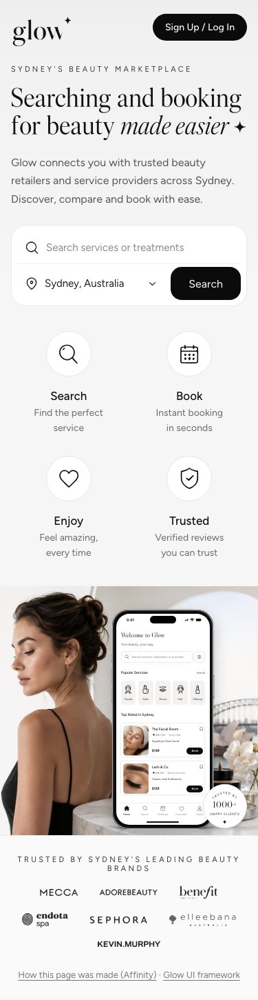 |

---

## What made the recreations accurate

These are the problems we hit in v1 and the fix for each. The fixes apply equally to Affinity and PhotoCraft.

| Problem in v1 | Fix in v2 | Tool |
|---|---|---|
| **Small icons redrawn by hand** looked roughly right but not the same: wrong stroke weight and wrong details (the Facials icon was an oval). | **Trace every icon from the design** with potrace at 8× after removing the background. The result is an exact vector shape in absolute design coordinates, used directly by the editors and the website. | [`tools/slicer.py`](tools/slicer.py) |
| **Brand logos were one flat image strip**, so they couldn't be moved, recoloured or reflowed on mobile. | **Auto-split the strip into one component per logo** at gaps of ≥ 30 empty columns, then trace each one to SVG. | `slicer.py` (`"split": true`) |
| **Faint, thin strokes vanished** (logo taglines, thin icon lines). | **A per-item ink threshold** (`"threshold": 0.28–0.35` for fine detail, 0.5 by default). | `slicer.py` |
| **Fonts were guessed by eye.** Bodoni 72 / Libre Caslon looked close but differed in letter widths and shapes. | **Measure it.** Render the same text in every Google Fonts family plus every installed font, then score **per letter** (line split into glyphs, each letter scaled the same way and compared by IoU). Whole-line scoring is misleading because spacing drift swamps shape differences. | [`tools/fontmatch.py`](tools/fontmatch.py) |
| **No free font matched the headline** (best per-letter score 0.72, a lookalike rather than a match). | **Build a font from the design itself.** Split the headline into letters, trace each one, take spacing from the measured gaps, and write an OpenType font (OTF + WOFF2). "Glow Display" Regular and Italic reproduce the headline exactly. | [`tools/glyphfont.py`](tools/glyphfont.py) |
| **The custom font's "o" carried a sliver of the neighbouring "b".** | Assign **every connected ink blob to exactly one letter** instead of cutting by bounding box. | `glyphfont.py` |
| **Photo slices were soft** at 1× and blurry on retina screens. | **Real-ESRGAN ×4**, blended 65/35 with a Lanczos upscale (so skin keeps texture), a light unsharp mask, and a **tone lock** that restores the original low-frequency colour so the slice still blends into flat backgrounds. Exported as @1x and -2x. | [`tools/enhance.py`](tools/enhance.py) |
| **A visible seam** where the photo met the page background. | The page background is a measured **vertical gradient** (#EEEEEE → #F6F6F6), not a flat grey. Sample it with 1-pixel rows across the seam. | measured, in `tokens.json` |
| **Colours and sizes drifted** between the editors and the web build. | **One set of design tokens** (`framework/tokens.json`), read by the website CSS and both editor builds. | [`framework/`](framework/) |
| **Positions and letter-spacing were set by eye** and drifted by 1–8px. | **Measure, don't guess.** `diffcheck.py` finds, per region, the sub-pixel shift that best lines the recreation up with the original. If the shift removes most of the difference, that shift *is* the correction. For evenly spaced text (where the shift search is ambiguous) compare **ink edges** (left, right, top, bottom) and turn width differences into letter-spacing. | [`tools/diffcheck.py`](tools/diffcheck.py) |
| **The custom font's spacing drifted along a line** (line 2 off by 7–8px at its end). | **Pair kerning.** For every neighbouring pair in the samples, the font stores the gap the advance widths miss, so sample lines are reproduced exactly (30 pairs regular, 8 italic). | `glyphfont.py` |
| **Glow Display only had the headline's letters.** | **Multi-size samples.** Extra lines (the badge's "1000+") are normalised to the headline's scale by x-height or cap height, or by an explicit `font_size_px`. Lines marked `"reference": true` set the scale. | `glyphfont.py` |
| **Small samples produced garbage glyphs** ("Welcome to Glow" at 20px came out unreadable, though its score looked fine). | **A proof sheet for every build**: each sample line rendered with the new font under the original, a per-line score, and a warning under 30px. Small text stays on the lookalike font. | `glyphfont.py` |
| **The last 2% was mostly text in a near-match font** (≈85% of the remaining mismatch). | **Pixel-exact mode:** every text block traced from the original and drawn as outlines, with live text kept underneath (transparent on the web, hidden layers in the editors). | `text_all_spec.json`, `slicer.py` |
| **Icons in flex layouts sat 0.5–1px off.** | Draw icons and logos in the overlay at their exact measured boxes. | `build.mjs` |
| **The CSS-drawn phone bezel couldn't match the photographed one** (0.6% on its own). | Drop the drawn frame and let the hero slice's real bezel show; draw only the screen, with its measured shape. | `styles.css`, `build_glow_v3.js` |
| **"White" and "black" weren't one colour each.** | Sample clean patches of every surface (median) and put them in the tokens: three blacks, five near-whites. | `tokens.json` |
| Enhanced photos differ from the original at 1×. | Original slice for 1×, enhanced for 2× (`srcset`); enhanced kept as hidden alternates in the editors. | `index.html` |
| **A build error went unnoticed** and a measurement ran on stale output. | The check script stops on build failure. Always rebuild before measuring. | — |
| Sub-pixel CSS nudges did nothing. | At 1× Chrome snaps text to whole pixels; nudge by whole pixels. | `src/styles.css` |
| Text sat about 0.2 em too high in Affinity. | Calibrate **first-baseline offsets** per font, measured with `diffcheck.py` (frame top = baseline − 0.73 × size for Helvetica Neue, 0.735 for Figtree, 0.75 for Bodoni 72, 0.702 for Glow Display). | `build_glow_v2.js` |
| Affinity showed every Figtree weight as 300. | Affinity misreads Figtree's variable-weight file. Generate **fixed-weight instances** with `fonttools varLib.instancer` (400/500/600/700) and install those. | see [Fonts](#fonts-in-the-editors) |

### Lessons from the last 0.1%

What the step from about 0.1% to 0.005% taught. Each point is measured; see the benchmark tables above.

1. **Attribute the error before fixing it.** Map every changed pixel to the element or shape whose box it falls in. Every round, two or three items held more than half the error, and they were rarely the ones that looked worst by eye.
2. **The renderer is part of the recreation.** The same kit scores differently in each tool, so calibrate in a loop with the real renderer (`calibrate.py`), measured on the max-fidelity export, where only shapes differ.
3. **Anti-aliasing density differs per renderer.** Affinity, PhotoCraft and Chrome draw filled paths lighter than Photoshop; a per-element hairline stroke in the fill colour (`inkgain.py`) corrects it. Check that the tool honours sub-pixel strokes first: Photoshop's SVG import doesn't.
4. **Don't redraw what's physical.** A photographed screen edge or a shaded badge rim isn't a vector outline. Let the photo provide the edge (`--photo-edges`) and build what's inside it.
5. **Things that overlap need geometry, not just stacking.** The drawn screen covered the photo's badge rim; subtracting the disc fixed it. Write the result as plain paths, because importers drop masks and clip paths.
6. **Boxes leak.** An element's box can include a neighbour's edge (the badge arc and the rim). Clip elements to their real region (`clip_elements.py`).
7. **Tune against what's really underneath** (`tune_shapes.py --under`), not a guess from the surroundings.
8. **Ship what can't be traced as original pixels, small and named:** strip edges, logo taglines, multi-tone marks (`split_parts.py`), the background plate. Each one is a separate named element, so the result stays editable.
9. **Keep "built" and "exact" apart.** Exact mode scores 0 by construction. The built version's score is the one that measures recreation quality, so report both, separately.
10. **Every refactor gets a byte-for-byte check.** Turning the pipeline into the project system was verified by regenerating every kit and exact-mode file and comparing them with `cmp`.

### Results of the tools on this design

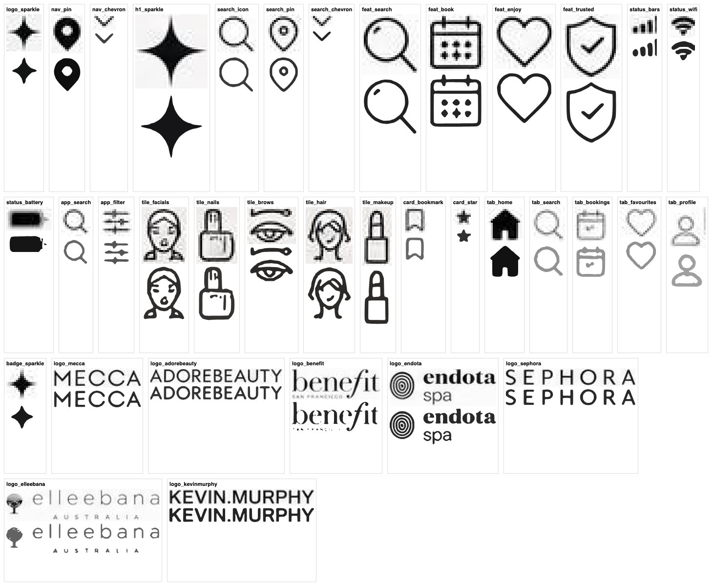

*Above: each traced component at 4× zoom, original pixels on top and the traced vector below.*

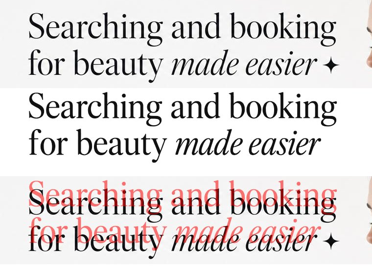

*Above, top to bottom: the original headline; the same words typed in the custom Glow Display font (identical shapes and spacing); an overlay.*

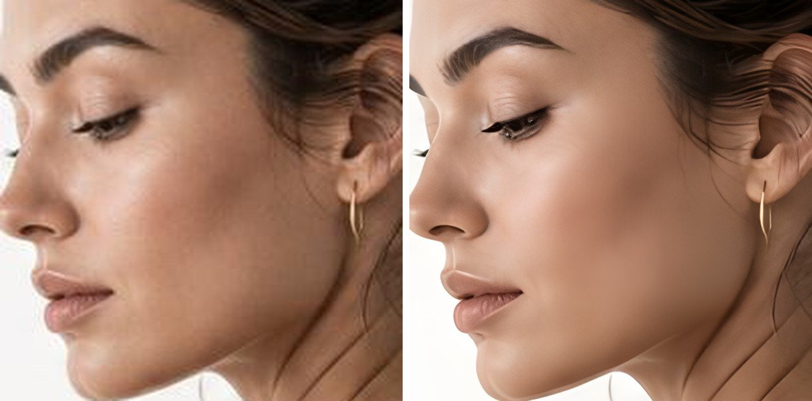

*Above: a plain 1× slice enlarged (left) vs. enhanced (right).*

---

## Recreate any design: the project system

Everything design-specific lives in one file, `projects/<name>/project.json`; every tool is generic. [`projects/glow/project.json`](projects/glow/project.json) is the full worked example. [`tools/recreate.py`](tools/recreate.py) runs the steps:

```bash
tools/setup.sh                                          # once: potrace, Python env, Real-ESRGAN
tools/.venv/bin/python tools/recreate.py new acme ~/designs/acme-landing.png   # scaffold projects/acme/
# 1. fill projects/acme/specs/*.json and project.json (see the reference below)
tools/.venv/bin/python tools/recreate.py acme all       # slice, tune, parts, clips, plate, shapes, exact
tools/.venv/bin/python tools/recreate.py acme kit photoshop --photo-edges 2 --out ~/acme_kit
# 2. build in each tool from the kit (scripts in editors/), export standard + max views
tools/.venv/bin/python tools/recreate.py acme calibrate photoshop ~/acme/render_max.png   # 2-3 rounds: rebuild kit, re-render
tools/.venv/bin/python tools/recreate.py acme inkgain website 0=r0.png 0.05=r1.png 0.1=r2.png 0.15=r3.png
tools/.venv/bin/python tools/recreate.py acme bench "Photoshop=render.png" "Photoshop max=render_max.png"
tools/.venv/bin/python tools/recreate.py acme diff render.png  # region report + heatmap
```

The whole chain was tested on a fresh scaffolded project: slice → tune → plate → shapes → kit → exact, with the exact layers recompositing to 0 differing pixels. Refactoring Glow onto the project system changed no output: every kit file and exact-mode layer is byte-identical to before (`cmp`).

### The steps and what each needs

| Step | Command | Needs in the project | Produces |
|---|---|---|---|
| 1. Trace elements and text | `slice` | `specs/components.json`, `specs/text.json`: `[{"name", "box": [x,y,w,h], "threshold"?, "split"?}]` | raw traces (`build/components`, `build/text`) |
| 2. Tune traces | `tune` | (step 1) | tuned vectors + original-pixel cutouts; tiny elements switch to cutouts |
| 3. Split parts | `parts` | `specs/parts.json`: `[{"parent", "name", "box", "cut_parent"}]` | parts as tiny cutout elements |
| 4. Clip elements | `clips` | `specs/clips.json`: `[{"name", "circle": [cx,cy,r]}]` or `"rect"` | traces and cutouts limited to their region |
| 5. Background | `plate` | `photos` (their boxes are masked) | `backdrop.png` (smooth) + `backdrop_plate.webp` (original background pixels where visible) |
| 6. Fit shapes | `shapes [--under img] [--edge-band N]` | `specs/shapes.json`: rect / circle / squircle with fill, stroke | `build/shapes_tuned.json` |
| 7. Kit per renderer | `kit <tool> [--photo-edges N]` | `drawn`, `photos`, `strips`, `repeat` | photo slices, shapes SVG, vector SVGs, cutout layers |
| 8. Calibrate | `calibrate <tool> <max render>` | a max-fidelity render from that tool | `calibration_<tool>.json` (used by step 7) |
| 9. Ink gain | `inkgain <tool> W=render ...` | renders with every vector stroked at W | `ink_gain_<tool>.json` (used by step 7) |
| 10. Exact mode | `exact` | `sections` | background + section layers that recomposite to the original |
| 11. Score | `bench`, `diff` | renders | benchmark table; per-region report and heatmap |

### `project.json` reference

| Key | Meaning |
|---|---|
| `design`, `size` | The design image and its size in px. All coordinates everywhere are design px. |
| `specs`, `raw`, `manifests` | Where specs live, where raw traces go, where tuned manifests go. |
| `shapes`, `shapes_tuned` | Shape specs for `tune_shapes.py`, and the tuned result. |
| `parts`, `clips` | Inputs for `split_parts.py` and `clip_elements.py`. |
| `plate`, `backdrop` | Background outputs (step 5). |
| `calibration`, `ink_gain` | Per-renderer files; `{tool}` is replaced by the renderer name. |
| `photos` | `[{"name", "file", "box", "patch_from_plate"?: [[x,y,w,h]]}]`: lossless slices. A patch replaces a bit of the slice that belongs to something drawn on top (text the slice cuts into). |
| `photo_under` | The photo that drawn shapes sit on (rim cleaning applies to it). |
| `strips` | `[{"name", "file", "box"}]`: rows or columns shipped as original pixels (a blended divider). |
| `repeat` | `[{"name", "dx", "dy"}]`: an element drawn again at an offset (card 2's icons). |
| `drawn` | Every drawn shape, in drawing order: `{"name", "kind": rect / circle / squircle / line, "box" or "points", "r", "rb", "k", "kb", "fill", "stroke", "over_photo"?, "subtract"?: [names], "follow"?: squircle}`. Tuned values from `shapes_tuned` override these by name. |
| `rims` | Shapes whose photo edge `clean_rims.py` may clean (when not using photo edges). |
| `sections` | Exact-mode sections in priority order: `{"name", "rect"}` / `{"name", "circle"}` / `{"name", "rest": true}`. |

### What stays per design

- **The website's HTML and CSS.** The page itself is the design, so it's hand-built: `src/index.html`, `styles.css`, `build.mjs`. The pixel-mode layer is generic and carries over: the plate background, the shapes SVG overlay, and traced vectors and cutouts at exact design coordinates (`.px` items with `--x --y --w --h`). The live HTML text sits underneath, transparent.
- **Editor build scripts.** The Photoshop scripts only place kit files, so they work for any project; change the kit path. Affinity's script draws shapes itself and is Glow-specific. PhotoCraft builds by commands, driven by an agent from the kit.
- **Fonts.** Run `fontmatch.py` per text style. When nothing scores 0.80 or above, build the font from the design with `glyphfont.py`.

---

## The pipeline

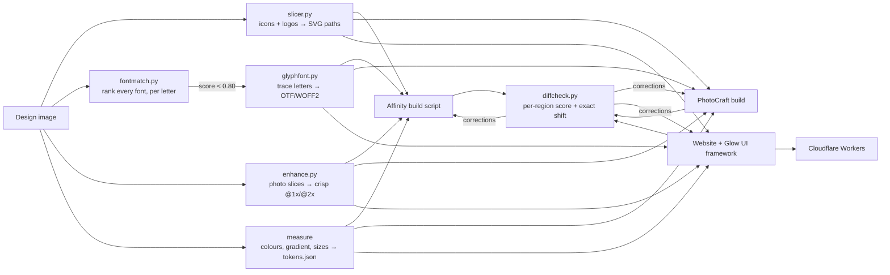

1. **Measure:** layout boxes, colours (sample rows and columns, not single pixels), text baselines and sizes. Put them in `framework/tokens.json`.
2. **Slice:** photos become raster slices (`sips` or `enhance.py`); icons and logos become traced vectors (`slicer.py`).
3. **Fonts:** run `fontmatch.py` per text style. If the best score is under 0.80, build the font with `glyphfont.py`.
4. **Build:** Affinity uses a pasted JavaScript build script; PhotoCraft uses batched commands plus an SVG import. Both read the same manifest and tokens.
5. **Verify:** run `diffcheck.py` on the export. Apply the shifts it reports, and fix letter-spacing from ink-edge widths. Re-run until every region's leftover shift is ≤ 0.5px, then check zoomed crops by eye (scores can miss garbled glyphs).
6. **Ship:** the website uses the same components, tokens and fonts. `npm run deploy:*` publishes it.
7. **Close the last 0.1%** (v4–v9): tune traces and shapes, add the plate, split parts and clip elements, build a kit per renderer (calibration, ink gain, photo edges), and benchmark standard, max and exact separately. [`tools/recreate.py`](tools/recreate.py) runs all of it from one project file.

---

## Tools

One-time setup on macOS (potrace, a Python env, Real-ESRGAN):

```bash
tools/setup.sh
```

### `slicer.py`: icons and logos to exact vectors

```bash
tools/.venv/bin/python tools/slicer.py design.jpg tools/glow_spec.json variants/shared/components
```

The spec is a list of rough boxes. The tool tightens each box to the ink, so rough boxes are fine:

```json
[
  {"name": "feat_search", "box": [100, 680, 40, 40]},
  {"name": "tile_brows",  "box": [1214, 408, 36, 40], "threshold": 0.35},
  {"name": "logo", "box": [100, 945, 1340, 60], "split": true, "min_gap": 30, "threshold": 0.28,
   "names": ["logo_mecca", "logo_adorebeauty", "logo_benefit", "logo_endota", "logo_sephora", "logo_elleebana", "logo_kevinmurphy"]}
]
```

For each component it writes:
- a transparent PNG (ink colour, alpha = ink strength);
- an SVG (local coordinates, for the web);
- a `manifest.json` entry with `box`, `colour`, `d` (SVG path) and `paths` (absolute M/L/C/Z segments in design pixels, for the editors).

**How it works:**
- The background colour is the median of the border pixels.
- Ink = colour distance from the background, normalised to the 99.5th percentile.
- It upscales 8× with Lanczos, thresholds, and traces with `potrace --alphamax 1 --opttolerance 0.2 --turdsize 4`.
- Holes come out as reversed subpaths, so both nonzero and even-odd fills work.

### `fontmatch.py`: find the font, one to one

```bash
tools/.venv/bin/python tools/fontmatch.py design.jpg --box 50 240 650 90 \
    --text "Searching and booking" --category serif --top 10 --out fonts/headline_roman.json
```

**Candidates:**
- Every Google Fonts family in the category, from the public metadata endpoint.
- Each family is downloaded as a TrueType subset of just the sample text, so it's a few KB.
- Every font installed in `/System/Library/Fonts`, `/Library/Fonts` and `~/Library/Fonts`, keeping only those that cover the sample characters.

**Scoring** (mean per-letter IoU):
1. The design line is upscaled 3× and split into letters (connected components; touching italic letters are split at the thinnest column).
2. Each candidate letter is scaled by the factor that matches line heights.
3. Its shape is compared, centred, with the original letter.

**Output:** a ranking with the font size and letter-spacing that reproduce the line, a JSON report, and an overlay sheet (grey = match, red/black = mismatch).

| Score | Verdict |
|---|---|
| ≥ 0.80 | near-exact match: use it |
| 0.70–0.80 | close lookalike |
| < 0.70 | probably a commercial or custom font: run `glyphfont.py` |

On this design:

| Text | Best result | Decision |
|---|---|---|
| Headline serif | 0.72 (Times-like faces; the original is probably a commercial display face) | custom **Glow Display** |
| Body sans | Mingzat, Fustat, **Figtree**, Host Grotesk and Google Sans Flex within 0.02 of each other at 18px | **Figtree**: its line width is identical to the original at the matched size |

> Small text (under about 20px) can't separate close candidates well. Break ties visually by rendering the candidates under the original line (see `fonts/` for the comparison approach), and prefer the one whose line width matches.

### `glyphfont.py`: make the font when none matches

```bash
tools/.venv/bin/python tools/glyphfont.py design.jpg fonts/glow_display.json fonts/out
```

```json
{"family": "Glow Display", "style": "Regular", "italic": false,
 "lines": [{"box": [52, 248, 644, 82], "text": "Searching and booking"},
           {"box": [52, 326, 290, 78], "text": "for beauty"}]}
```

**Steps:**
1. Split each line into letters, assigning every ink blob to exactly one letter.
2. Measure the baseline (median bottom of letters without descenders).
3. Estimate the em size from ascender height ÷ 0.72.
4. Trace each letter.
5. Set side bearings from the measured gaps, and the space width from word gaps.
6. Write a CFF OpenType font with `fontTools.fontBuilder`, plus WOFF2 and a JSON report.

**Upgrades from the "fix it further" pass:**
- **Kerning:** every neighbouring pair in the samples gets a GPOS kerning value (measured gap minus what the advance widths give), including pairs around spaces.
- **Several sizes:** add sample lines at other sizes. Each is normalised to the reference scale by x-height, or by cap/digit height if it has no x-height letters, or by `font_size_px`. Mark the main lines with `"reference": true`. When a letter appears more than once, the first sample wins, so put the largest samples first. The report lists the font size that reproduces every sample line (`line_sizes_px`).
- **Proof sheet** (`<Family>-<Style>-proof.png`): every sample line rendered with the new font under the original, laid out with the font's own kerning, plus a per-line score and a warning for samples under 30px.

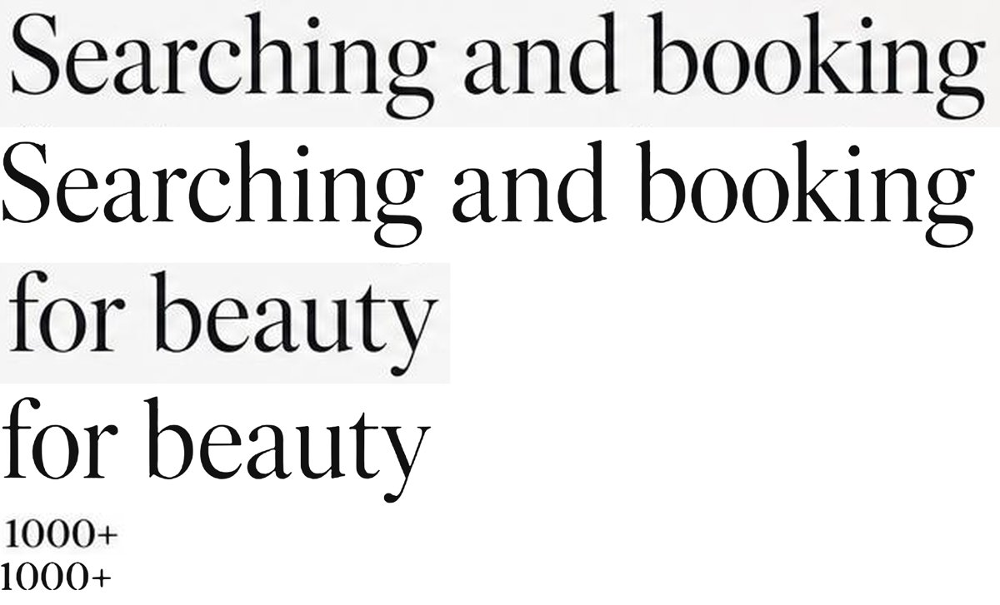

> **Lesson:** below about 30px, letters in a sample touch and segmentation fails. "Welcome to Glow" at 20px produced garbled glyphs even though its overall score looked fine. Keep small text on the lookalike font and always look at the proof sheet.

**Using the result:**
- The report includes `font_size_px`, the size that reproduces the design (73.4px here).
- The font only contains the letters in the samples (here: `+01GSabcdefghiknortuy` plus the italic `adeimrs`). List a lookalike after it in your font stack (`"Glow Display", "Libre Caslon Display", serif`).
- Text whose letters aren't covered should use the lookalike directly. Mixing fonts inside one word looks wrong; that's why the wordmark is a traced logo rather than text.
- More samples at the same size give more letters. Lines at different sizes need separate runs.

### `enhance.py`: crisp photo slices

```bash
tools/.venv/bin/python tools/enhance.py variants/affinity/assets/hero.jpg variants/affinity/assets/hero_hd
# writes hero_hd.jpg (1x) and hero_hd-2x.jpg
```

**Steps:**
1. Real-ESRGAN `realesrgan-x4plus`.
2. Downscale to 2×.
3. Blend 65% AI with 35% Lanczos; pure AI looks airbrushed.
4. Apply an unsharp mask (radius 1.2, 40%).
5. Tone lock: `result + blur(original) − blur(result)` with a 6px Gaussian. This keeps the new detail but the original's colour and brightness, so slices don't show seams.

Use `--blend` to tune it. Lower means more natural texture; higher means sharper.

### `tune.py`: auto-tune every traced element

```bash
tools/.venv/bin/python tools/tune.py design.jpg variants/shared/text_all/manifest.json variants/shared/text_all_tuned --raster-max 15
```

**How it searches:** for each element in a slicer manifest, it tries 7 trace thresholds × 25 sub-pixel offsets. For each candidate, the best fill colour is solved in closed form: c = Σα(orig − bg·(1−α)) / Σα², where α is the candidate's coverage. Every candidate is scored by simulating the render at 8× supersampling with even-odd fill.

**Cutouts:** elements whose shorter side is at most `--raster-max` px also get scored as an original-pixel cutout. If that's at least 30% closer, they're marked `"mode": "raster"`.

**Output:** a manifest in the same format, with a `tune` record (threshold, dx, dy, error before and after) for each element.

### `tune_shapes.py`: fit every drawn shape to the original

```bash
tools/.venv/bin/python tools/tune_shapes.py design.jpg tools/glow_shapes.json tools/glow_shapes_tuned.json \
  --exclude variants/shared/components_tuned/manifest.json --exclude variants/shared/text_all_tuned/manifest.json \
  --exclude-box 1104,543,80,97 --exclude-box 1104,664,80,96
```

**How it works:**
- The input is a list of rectangles (with corner radius) and circles, plus their fills and borders.
- It searches x, y, w, h and radius by coordinate descent (1 → 1/8px, capped at ±3px), and solves fill and border colours by least squares.
- Each candidate is scored on an 8× supersampled render. Outside the shape it compares against the original pixels; at the edge, against the local surround.
- Traced elements, photos (`--exclude-box`) and shapes nested inside are excluded. A result is only kept if it beats the starting values.
- The website applies the tuned values through a generated `framework/shapes.css`. Flex and grid children get a top-left-anchored `scale`, so resizing them doesn't push their neighbours along.
- **Kinds:** `rect` (one corner radius), `circle`, and **`squircle`**: a rounded rectangle with a top radius `r`, bottom radius `rb` and corner smoothing `k` / `kb`. Each corner is one cubic Bézier; `k = 0.5523` is a circular arc, and larger values give the flatter, continuous corner of iOS screens and app icons.
- **`--under image`**: score each candidate composited over the real layer underneath (for example the plate with the photo slice), plus every enclosing shape painted in, instead of estimating the background from the surroundings. Use it for shapes over photos.
- **`--edge-band N`**: score only pixels within N px of the outline, for large shapes whose interior holds other content (a phone screen full of UI).
- **`--stroke-widths 0.5,1,1.5`**: also fit the border width. **`--only a,b`** tunes just those shapes; **`--max-move`** caps how far geometry may move.

### `make_kit.py`: the editor import kit

```bash
tools/.venv/bin/python tools/make_kit.py ~/Downloads/glow_v5_kit [--project projects/glow/project.json] [--calibration tools/calibration_photoshop.json]
    [--ink ink.json | --ink-all 0.1] [--photo-edges 2] [--no-clean-rims]
```

**What it writes:** everything an editor needs, at design coordinates — the backdrop and full-resolution `backdrop_plate.png`, `strip_edge.png`, lossless photo slices (the hero with the "About Us" sliver cleaned), `shapes_tuned.svg` + `shapes_tuned.json`, `vectors_tuned.svg`, `vectors_tiny_hidden.svg` and `vectors_all.svg`, `cutouts_tiny.png`, and `cutouts_all_max_fidelity.png`. The intended layer order is in the script's docstring.
- `--calibration` applies a renderer's measured shape corrections (`calibrate.py`).
- `--ink` / `--ink-all` stroke the traced vectors in their own colour (`inkgain.py`). Only for renderers that honour sub-pixel SVG strokes: Photoshop's SVG import doesn't.
- `--photo-edges N` insets the shapes marked `over_photo` by N px with no border, so their outermost edge comes from the photo. It also subtracts the listed discs (the badge) from them, written as plain polygon paths, simplified with Ramer-Douglas-Peucker to about 240 points for the screen. This is what took every tool to 0.004–0.006% in max mode.
- Everything design-specific (shape list and order, photo slices, strips, repeats) comes from the project file.

### `calibrate.py`: correct shapes against a tool's real render

```bash
tools/.venv/bin/python tools/calibrate.py design.jpg render_max.png tools/glow_shapes_tuned.json calib.json \
  --exclude variants/shared/components_tuned/manifest.json --exclude variants/shared/text_all_tuned/manifest.json \
  --exclude-box 1104,543,80,97 --exclude-box 1104,664,80,96 [--prev calib.json]
```

`tune_shapes.py` fits shapes against a *simulated* renderer, but each tool anti-aliases and snaps a little differently. `calibrate.py` puts the real renderer in the loop. In the tool's max-fidelity export it takes a 4px band across each of a shape's four edges (corners, text, icons and photos masked) and finds the 1D shift, in 1/8px steps, that best matches the original. Left/right shifts become `dx`/`dw`, top/bottom become `dy`/`dh`. It applies 60% per round (damping) and only shifts that clearly help, so it accumulates with `--prev`. Two or three rounds converge. One calibration file per renderer: `tools/calibration_{website,photoshop,affinity}.json`.

### `inkgain.py`: per-renderer edge-coverage correction

```bash
tools/.venv/bin/python tools/inkgain.py design.jpg tools/ink_gain_<tool>.json --render 0=r0.png --render 0.05=r1.png --render 0.1=r2.png ...
```

Measured against the original, every tool draws the traced fills a little light: anti-aliased edge pixels get less coverage than the original's renderer gave them. Affinity, PhotoCraft and Chrome are lighter than Photoshop. Fix: stroke each traced path in its own fill colour with a hairline (0.05–0.2px). That adds edge coverage without moving the shape. Render the design once per width with every vector stroked at that width (`GLOW_INK_ALL=W node build.mjs`, `make_kit.py --ink-all W`, the Affinity sweep, or PhotoCraft `shape.edit {"stroke": {"width": W, ...}}`). `inkgain.py` then picks the best width per element.

| Tool | Standard mode, before → after |
|---|---|
| Affinity | 0.110% → 0.079% |
| Website (Chrome) | 0.065% → 0.052% |
| PhotoCraft | 0.052% → 0.044% |
| Photoshop | no gain: its SVG import ignores sub-pixel strokes, and a duplicate layer at partial opacity (the raster equivalent) made it worse. Its edges already match. |

### `split_parts.py`: split untraceable parts out of a traced element

```bash
tools/.venv/bin/python tools/split_parts.py design.jpg variants/shared/components_tuned/manifest.json tools/glow_parts.json
```

Some parts of a logo can't be a single-colour vector at 1×. Benefit's 4px "SAN FRANCISCO" tagline drops out of the trace entirely, and the elleebana tree is multi-tone (a shaded canopy), so its flat trace was one grey blob. Each part in `tools/glow_parts.json` becomes its own element: a trace plus an original-pixel cutout, in `raster` mode like every other tiny element. With `cut_parent`, the parent's subpaths inside the part's box are removed. Parts carry `part_of`, so max-fidelity mode skips them (the parent's full cutout already contains them). This took 0.010–0.011% off standard mode in every tool.

### `clip_elements.py`: keep an element inside its region

```bash
tools/.venv/bin/python tools/clip_elements.py variants/shared/text_all_tuned/manifest.json tools/glow_clips.json
```

Removes the subpaths whose centre falls outside the region, and zeroes the cutout's alpha there. Regions are `{"circle": [cx, cy, r]}` or `{"rect": [x, y, w, h]}`. Use it when an element's box overlaps a neighbouring edge. The badge's "TRUSTED BY" arc had picked up 2 rim fragments and 297 rim pixels; clipping it took the website's max mode from 0.010% to 0.006%.

### `clean_rims.py`: remove a photo's own edges under drawn shapes

```bash
tools/.venv/bin/python tools/clean_rims.py hero_slice.png hero_clean.png --shapes tools/glow_shapes_tuned.json --x0 712 --y0 0
```

When shapes are drawn over a photo slice that already contains them, every edge gets anti-aliased twice. This replaces a band from 2px inside to 2px outside each outline with the colour 3px out, sampled along the normal from a signed-distance field (rounded rects with per-corner radii). Shapes are processed in drawing order, so nested ones sample their parent's interior. `make_kit.py` applies it unless `--photo-edges` is used. It's right for flat UI drawn over a screenshot. It's wrong for physical edges (a photographed device or a shaded rim), where photo edges win. `paint_parents()` builds the matching background image for `tune_shapes.py --under`.

### `exact_layers.py`: the original as named layers

```bash
tools/.venv/bin/python tools/exact_layers.py design.jpg framework/backdrop_plate.webp out/exact [--project projects/glow/project.json]
```

Writes the plate plus one opaque, non-overlapping layer per section (the original's pixels over that section's foreground), and `layers.json` with names in stacking order. It verifies that the recomposite equals the original (0 differing pixels) before reporting. The editors place each PNG at (0,0) in a top group.

### `recreate.py`: the orchestrator

See [Recreate any design](#recreate-any-design-the-project-system). It runs every tool above with the project's paths, so a new design only needs its specs and `project.json`.

### `backdrop.py`: extract the original's empty background

```bash
tools/.venv/bin/python tools/backdrop.py design.jpg framework/backdrop.png --manifest components.json --manifest text.json --mask 712,0,824,894 ... [--plate framework/backdrop_plate.webp]
```

**How it works:** it masks traced elements, given boxes and anything that stands out from its local median, then averages the rest in 8px cells and fills masked cells by diffusion. Stretched back to full size, the small image reproduces the background's real shading.

**`--plate`** also writes a full-resolution background plate. It keeps the original's own background pixels wherever nothing is drawn on top (about 30% of the canvas, so its exact JPEG grain is kept) and uses the smooth backdrop under foreground elements. The foreground mask is the element boxes plus real edges: anything more than 12 levels from its local median, grown by 3px. A 4-level threshold was too greedy and swallowed the background's own noise. All four tools place the plate as their bottom layer.

### `benchmark.py`: score versions against the original, with a noise floor

```bash
tools/.venv/bin/python tools/benchmark.py design.jpg --entry "Website v4=site.png" --entry "Affinity v4=aff.png" --md results.md --json results.json
```

**What it reports:**
- **Changed %**, **SSIM** (Gaussian window, σ 1.5), **ΔE2000** (mean and 95th percentile, full CIEDE2000) and **PSNR**.
- **Floor rows:** the original re-saved as JPEG at its own estimated quality (read from its quantisation tables), and at quality 95.

### `diffcheck.py`: measure the remaining mismatch, region by region

```bash
tools/.venv/bin/python tools/diffcheck.py original.jpg recreation.png --regions tools/glow_regions.json --out diff.png --json diff.json
```

```
overall similarity 0.9846  changed 2.51%
  headline_2_italic   29.59%  similarity 0.86  -> move by [-4.0, -0.5] to reach 4.44%
  intro_2             17.45%  similarity 0.94  -> move by [2.5, -0.5] to reach 12.62%
```

**What it reports:**
- For each named region (or a 6×4 grid): **similarity** (1 − mean colour difference after a 0.7px blur) and **changed %** (pixels off by more than 12%).
- The **sub-pixel shift** that best lines that region up with the original (whole-pixel search, then 0.5px refinement). If the shift removes most of the difference, the content is right and only its position is wrong, so apply exactly that shift.
- A red heatmap of every difference.

**For text lines, also compare ink edges.** Take the left, right, top and bottom ink edges in the original and the recreation:
- Width difference ÷ (characters − 1) = the letter-spacing correction per gap.
- Top difference = the baseline correction.

Edges are more reliable than the shift search for evenly spaced capitals, where many shifts look almost equally good.

---

## Affinity guide

**How it connects:**
- The Affinity app runs its own MCP server at `http://localhost:6767/sse`.
- Claude writes JavaScript against Affinity's SDK and runs it with `execute_script`.
- Always read the `preamble` topic first; the server enforces this and also returns saved hints in it.

**Hard limits** (built into Affinity; your Claude config can't change them):
- **Files:** only `~/Desktop` (`app.userDesktopPath`). Put inputs in a Desktop folder.
- **No `eval` / `new Function`:** a script on disk can't be loaded and run, so paste the whole script into `execute_script`. Reading data with `File.readAll(path).toString()` plus `JSON.parse` works, which keeps scripts small: the 37 traced components come from a 330 KB JSON file instead of the script.
- **Fonts:** Affinity loads its font list at startup. After installing fonts, restart Affinity (with no unsaved documents). It may pick up some new fonts dynamically, but cached fonts don't update until a restart.
- **Output:** `console.log` is the only way to get data back. Check visually with `render_spread` or by exporting a PNG and reading it.

**Build scripts:**
- [`editors/affinity/build_glow_v1.js`](editors/affinity/build_glow_v1.js): v1, with hand-drawn icons.
- [`editors/affinity/build_glow_v2.js`](editors/affinity/build_glow_v2.js): v2. It reads the manifest and tokens, builds every traced icon and logo as a filled `PolyCurveNode`, sets the headline in Glow Display (falling back to traced outlines if the font is missing), and places the 2× photos at 0.5 scale so a 2× export stays crisp.
- [`editors/affinity/build_glow_v6.js`](editors/affinity/build_glow_v6.js): **v6, current**. Adds the background plate, the strip edge as original pixels, the cleaned hero, and the split-out logo parts. Shapes come from `shapes_tuned.json` (write it with `make_kit.py --calibration tools/calibration_affinity.json` and copy it to the Desktop folder), and the per-element ink gain from `ink_gain.json` (a copy of `tools/ink_gain_affinity.json`). It exports `glow_landing_v6.png` and `_max.png` and saves the `.af`. Paste it without its comment lines.
- [`editors/affinity/build_glow_v3.js`](editors/affinity/build_glow_v3.js): v3, pixel-exact. It adds a group of traced outlines for all 55 text blocks, hides the live text frames (found afterwards by walking the layer tree, because a newly added node isn't `group.children.first`), uses the photographed bezel, the measured colours and the original 1× photos, and keeps the enhanced 2× photos as hidden layers.

**SDK patterns that work.** All of these are saved as Affinity SDK hints, so future sessions see them in the preamble:

```js
// document in pixels
const o = NewDocumentOptions.createDefault(); o.units = UnitType.Pixel; o.dpi = 72; o.width = 1536; o.height = 1024;
const doc = Document.createFromOptions(o);

// rounded rectangle (setting only the radius silently does nothing)
const s = ShapeRectangle.create(); s.setAbsoluteSizes(true, w, h);
for (const c of [s.topLeft, s.topRight, s.bottomLeft, s.bottomRight]) { c.cornerType = ShapeCornerType.Round; c.setRadius(r, w, h); }
doc.addNode(ShapeNodeDefinition.create(s, new Rectangle(x, y, w, h), FillDescriptor.createSolid(RGBA8(0,0,0,255)), null, null, null));

// traced path → filled vector node
const b = CurveBuilder.create(); b.beginXY(x, y); b.addBezierXY(c1x, c1y, c2x, c2y, x2, y2); b.close();
const poly = PolyCurve.create(); poly.addCurve(b.createCurve());
doc.addNode(PolyCurveNodeDefinition.create(poly, fill, FillDescriptor.createNone(), LineStyleDescriptor.create(LineStyle.create({weight: 0})), FillDescriptor.createNone()));

// 2x image at half scale (crisp 2x export); A.multiply(B) applies B first
im.transform = Transform.createTranslate(x, y).multiply(Transform.createScale(0.5, 0.5));
```

- **Groups:** add a `ContainerNodeDefinition`, then `doc.addNode(def, doc.layers.first)`. New nodes go on top.
- **Gradients:** `Gradient.create(stops)` → `GradientFill.create(grad, GradientFillType.Linear)` → `FillDescriptor.create(fill, false, transform, BlendMode.Normal, false)`. The transform maps a unit segment along +x.
- **Rotated text (badge arc):** build each letter's frame around the origin, then `new TransformBuilder().rotate(θ).translateXY(x, y).transform`.
- **Saving helpers:** the script library holds a "UI recreation helpers" starter. Read it before a new build instead of rediscovering the APIs.

---

## Photoshop guide

Photoshop 2026, installed locally, was driven with ExtendScript through AppleScript. The scripts are in [`editors/photoshop/`](editors/photoshop/), with helpers and text in `lib.jsx` and `text.jsx`:
- v5: `build.jsx` + `export.jsx`.
- v6: `build_v6.jsx` + `export_v6.jsx`, which add the strip edge.
- v7: `build_v7.jsx` + `export_v7.jsx`. These add the background plate, calibrated shapes and the split-out logo parts.
- v8: v7 + [`exact.jsx`](editors/photoshop/exact.jsx), which adds the exact-mode group on top (0 differing pixels).
- **v9: the same scripts on the v9 kit**, built with `make_kit.py ~/Downloads/glow_v5_kit --calibration tools/calibration_photoshop.json --photo-edges 2`. That adds photo edges, the badge subtracted from the phone and the clipped badge arc. Then `exact.jsx` adds the exact group and saves `glow_ps_v9.psd`. Scores: **0.024% standard, 0.004% max, exact 0 px.**

The layered results are `glow_ps_v5.psd` … **`glow_ps_v9.psd`**. In v9, the exact group is visible by default; hide it to see the rebuild.

> When a script is fed in as text (`do javascript (read POSIX file …)`), `#include` paths must be absolute. Rewrite `#include "lib.jsx"` to the absolute path in a run copy. Build the kit first with `tools/make_kit.py ~/Downloads/glow_v5_kit`.

```bash
osascript -e 'tell application "Adobe Photoshop 2026" to do javascript (read POSIX file "/abs/path/editors/photoshop/build.jsx")'
```

**Layers, bottom to top:** Backdrop plate · Hero photo (original pixels) · Shapes (tuned, vector smart object) · Card photos · Tuned vectors (vector smart object) · Tiny elements (vectors, hidden) · Tiny elements (original pixels) · Max fidelity (hidden) · Live text (editable, hidden).

**Tested tips:**
- **Running scripts:** the value of the script's last expression comes back on stdout. `#include "lib.jsx"` shares helpers.
- **Every script:** start with `app.preferences.rulerUnits = Units.PIXELS` and `app.displayDialogs = DialogModes.NO`.
- **Colour:** create the document in sRGB, `app.documents.add(1536, 1024, 72, name, NewDocumentMode.RGB, DocumentFill.WHITE, 1, BitsPerChannelType.EIGHT, "sRGB IEC61966-2.1")`, so nothing is ever converted. The automatic white Background layer has to be turned into a normal layer and deleted.
- **Placing:** Place Embedded through ActionManager (`executeAction(charIDToTypeID("Plc "), desc)`). SVGs come in as **vector smart objects** at their own size, 1:1 at 72 ppi.
- **Checking positions:**
  - Don't trust `layer.bounds` on placed files with transparent edges; it measures visible pixels. Read `smartObjectMore.transform` and `.size` with `executeActionGet`.
  - Place centres the file, so odd sizes land on half pixels (an 80×97 thumbnail started at y = 463.5). Translate by `target − transform[0..1]`.
- **Text:** `app.preferences.typeUnits = TypeUnits.PIXELS`, then `textItem.position = [x, baselineY]` puts a point-text baseline exactly; `textItem.font` takes PostScript names.
- **Export:** use `exportDocument(..., ExportType.SAVEFORWEB, opts)` with PNG8 = false, transparency = false and includeProfile = false. Toggle visibility between exports to get several variants, then save the PSD last.
- **Effort:** about 12 tool calls and ≈45k tokens, the cheapest of the four tools, because the kit did the work.
- **Adobe's MCP connector:** this session also has a "claude.ai Adobe" MCP connector, but it is cloud-based and needs signing in (`/mcp`). Driving the installed app needs no connector.

## PhotoCraft guide

**Latest: `glow_v8.pcraft`** (0.020% standard, 0.005% max; exact group 0 px), built from v6/v7 by an agent with the v9 kit's geometry:
- **Replacing shape geometry:** `shape.edit` on the screen and tab bar layers takes the kit's polygon paths (about 240 and 112 points) and keeps each layer's id, name and z-order. The badge became an ellipse 135px across with no border.
- **Swapping a traced vector:** the tx_badge_arc path was replaced by the clipped trace placed at its box origin.
- **Re-placing raster layers:** the cutout layers were re-placed at (0,0) with the regenerated PNGs. Their ids change: 983 → 1033 and 980 → 1034.
- **Files must be inside PhotoCraft's automation root.** It couldn't read the kit PNGs from a temp folder; copy them under the root first.
- **Large path edits are expensive in tokens:** the command echoes the whole path back. Simplify paths first (the kit's RDP pass) or import from a file.
- **Exact mode:** 9 full-canvas PNGs in a top group. Paste results report offset (0,0) for full-canvas sources, so verify with a test export instead (0 differing pixels).

**How it connects:**
- `photocraft-cli mcp` runs a headless engine over stdio.
- Edits go through `command_run` / `command_batch`, with documents handled by `doc_*`.

**Setup.** File access is limited to the folders passed at launch:

```bash
claude mcp add photocraft -s user -- photocraft-cli mcp \
  --automation-read-root ~/Design --automation-write-root ~/Design
```

Use a dedicated folder: the roots are the only fence on what an agent can read and overwrite. Reconnect with `/mcp` after changing them. A server started before you install fonts won't see them.

**Disabled in automation, by design:**
- **Save for Web** (slice export) and **Place Embedded / Place Linked.** These take paths from file dialogs, which would get around the root fence.
- **Workaround for slicing:** crop → `doc_export` → undo.
- **Workaround for placing images:** `doc_open` the image, `select.all` + `edit.copy`, `doc_select` the target, then `edit.paste {center:[cx,cy]}`.

**Tips from the v2 run** (tested):
- **Paths: go through SVG.** Write one SVG at document size with one `<path id="name" fill="#hex" d="…">` per element, in absolute coordinates. `doc_open` gives one named shape layer per path, keeping fills and holes. In that document run `select.allLayers` → `layer.groupLayers` → `edit.copy`, then `edit.pasteSpecial.pasteInPlace` in the target. Without the group, only the active layer is copied. [`editors/photocraft/v2_traced.svg`](editors/photocraft/v2_traced.svg) is the file used here.
- **Inline paths are expensive.** `shape.create {kind:"path", path:{subpaths:[{knots}]}}` works, but the knots JSON is about 2× the size of SVG `d` strings, and every `shape.create`, `shape.edit` and `shape.info` reply echoes the whole path back. This was the main token cost of v1.
- **Half-pixel image centres work:** center `[1144, 591.5]` on a 97px-tall image lands at y = 543. The paste result reports `offset`, so you can check placement without re-inspecting.
- **Fonts:** check with `type.fonts {"family":"Name"}`. An empty `faces` list means the font isn't loaded. **Never** call `type.fonts` without a family; it returns about 195k characters.
- **Batching:**
  - `command_batch` handles dozens of `layer.delete`, `layer.hideLayers`, `layer.renameLayer` or `layer.select` steps cheaply.
  - It stops at the first error and reports how many steps completed.
  - It can't switch documents; call `doc_select` between batches.
- **Small fixes:**
  - `layer.duplicate` followed by `shape.edit {move:[dx,dy], name}` duplicates and repositions a shape.
  - `type.setStyle {range:[0,1], color:[0,0,0,0]}` hides one glyph without reflowing the text.
- **Verbose output to avoid:**
  - `doc_inspect` on a document with 100+ layers returns about 25k characters each call; note layer ids once and reuse them.
  - Broad `command_list` filters: `"type."` returns about 10k characters. Use specific filters.
  - `doc_close` and `doc_select` return the whole session list.
- **Pitfalls:**
  - `doc_open` on a file that's already open gives a new index; always use the index it returns.
  - Closing documents renumbers higher indices, so close from the highest down.
  - The PNG export warns "layers flattened"; that's expected.
- **Text corrections** (from the measured-fix pass):
  - `type.setStyle` with `"range":[start,end]` sets tracking per line inside one multi-line Type layer; `type.info` `lines[].start/end` gives the ranges.
  - Tracking is in 1/1000 em: to change a line's width by W px over n characters at size s, use Δtracking ≈ W × 1000 / ((n − 1) × s). This was accurate to about 1px.
  - `type.edit {"move":[dx,dy]}` accepts fractional pixels. Centre-aligned text stays centred when its tracking changes.
  - A positive `baselineShift` on a range moves those glyphs up. `firstLineIndent` of 0.5pt does nothing visible on point text, so it can't be used for sub-pixel nudges.
  - `type.setStyle` and `type.edit` return the full `type.info` payload every time, so batch them and skip a separate `type.info` afterwards.
  - `layer.hideLayers {"layer":id}` hides a layer by id without selecting it.
  - Check `session_list` before `doc_open`: opening a .pcraft that's already open creates a second copy, named from inside the file.
- **Pixel-exact pass** (tested):
  - A single 79-step `command_batch` with `"stop_on_error": false` (hides, renames, fills) ran in one call with no failures.
  - `shape.edit` returns the whole path for every edited layer, so 20 fill edits cost about 8k tokens. Batch them anyway.
  - `shape.edit` with `"name"` renames in the same step. `"radii"` takes one number or `[tl,tr,br,bl]`, and `"rect"` regenerates a live rounded rectangle.
  - `layer.duplicate` followed by `shape.edit` (new rect, radii and fill) is a quick way to add a shape.
  - `layer.select` on a group, then `edit.pasteSpecial.pasteInPlace`, puts the pasted group above that group at the top level.
  - `doc_export` to .png doesn't change the document's save path. Use `doc_save` with an explicit new .pcraft path so the source file is never overwritten.
- **v5 pass** (tested):
  - `doc_select` returns every open document (about 3k tokens with 18 open), so close kit documents once you've copied from them.
  - `layer.select` on the target, then `edit.pasteSpecial.pasteInPlace`, puts the paste directly above it, so no reordering is needed.
  - A group pasted above a hidden group comes in visible and needs `layer.hideLayers`.
  - For stroked shapes measured to their outer edge, set `align: "inside"` on the stroke.
- **Checking the result:** stack original and render crops vertically (ImageMagick `-append`, or Pillow) and view them. This is cheaper and sharper than `render_preview`.

---

## Glow UI framework

A design system measured from the photo, so new pages built from it look like the original. See it live at [/framework](https://glow-affinity.i-quietus.workers.dev/framework).

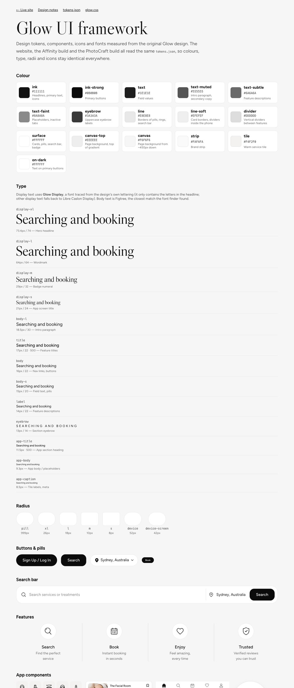

| File | What it is |
|---|---|
| [`framework/tokens.json`](framework/tokens.json) | Design tokens in W3C format: 16 colours, 3 font stacks, 13 type styles, radii, sizes, spacing, shadows. The website and both editor builds read it. |
| [`framework/glow.css`](framework/glow.css) | CSS variables (`--gl-*`), `@font-face` for Glow Display, type classes, and components: `gl-btn`, `gl-pill`, `gl-search`, `gl-feature`/`gl-ring`, `gl-card`, `gl-tile`, `gl-tabbar`, `gl-badge`, `gl-device`, `gl-logos`. All flow-layout and responsive. |
| `framework/icons.svg` (generated) | One `<symbol id="gl-NAME">` per traced icon. The fill follows CSS `color`. |
| `framework/fonts/` (generated) | Glow Display Regular/Italic as WOFF2 and OTF. |

Usage:

```html
<link rel="stylesheet" href="framework/glow.css">
<a class="gl-btn" href="#">Sign Up / Log In</a>
<span class="gl-ring"><svg class="gl-icon" style="width:29px;height:31px"><use href="framework/icons.svg#gl-feat_search"/></svg></span>
```

**Design rules from the measurements:**
- **Colour:** near-black ink (#111) on a soft grey gradient. Every control is either white with a 1px #E8E8E8 border, or near-black (#0B0B0B) with white text.
- **Radius:** pill-round for controls, 26px for the hero search bar, 10px for cards and tiles.
- **Type:** high-contrast serif display (Glow Display) for headlines and the badge numeral only; Figtree for everything else. Eyebrows are 13px uppercase with 0.3 em letter-spacing.
- **Icons:** 1.5–1.7px line icons, about 20px in controls and 30px in feature rings.

---

## Website and deployment

The site is static HTML and CSS: [`src/index.html`](src/index.html) and [`src/styles.css`](src/styles.css).

- **Desktop (≥ 1024px):** every measurement is `calc(N * var(--u))`, where `--u = 100cqw / 1536` (a container-query unit), so the page is 1:1 with the design at any desktop width.
- **Phone mockup:** scales with its own container (`--v = 100cqw / 824`).
- **Below 1024px:** a stacked mobile layout.
- **Icons:** traced icons are sized from their measured dimensions (`style="--w:29;--h:31"`, with `--k` as the unit of the current layout).

```bash
npm install
npm run build                    # dist/affinity and dist/photocraft
CLOUDFLARE_ACCOUNT_ID=<your account id> \
AFFINITY_URL=https://glow-affinity.<sub>.workers.dev PHOTOCRAFT_URL=https://glow-photocraft.<sub>.workers.dev \
  npm run deploy:affinity && npm run deploy:photocraft
```

Each variant is a Workers static-assets site (`wrangler.<variant>.jsonc`) containing the live page, `/design` (comparison sliders and stats) and `/framework`, with a custom 404 page.

---

## Affinity vs. PhotoCraft: token usage

| | Affinity | PhotoCraft |
|---|---|---|
| **v1** run order | First, with no prior knowledge | Second, given the measurements from the Affinity run |
| **v1** tokens (context) | ≈ 174k (≈ 135k excluding session overhead) | ≈ 146k |
| **v1** tool calls | ≈ 82 | 58 |
| **v1** main cost | Learning the SDK (docs, experiments) | Shape commands echoing full path data |
| **v2** upgrade tool calls | ≈ 10 (2 build runs + checks) | 81 |
| **v2** upgrade tokens | ≈ 25k | ≈ 151k (two 133-layer `doc_inspect` dumps ≈ 50k) |
| **v2** headline | Live text in Glow Display | Traced outlines (server started before the font was installed) |
| Editable layers (v1) | 164 in 8 groups | 133 |

**Takeaways:**
- **Output quality is a tie.** Both reach about 1px alignment once they use the same traced assets.
- **Affinity is cheaper to iterate.** A script is reusable, reads data files, and a rebuild is one call.
- **PhotoCraft is cheaper per edit** for small changes, but costly for large vector imports unless you go through SVG.
- **The shared tools did most of the work.** Once icons, fonts and photos are prepared outside the editor, either editor only has to place them.

Token figures come from the context counter, not a billing meter. The runs weren't like-for-like (see "run order").

---

## Checklist for a perfect 1:1 recreation

**Measure first**
- [ ] Get the design at its native resolution. Note the canvas size and work in its pixel units (1 design px = 1 unit everywhere).
- [ ] Sample colours with 1-pixel **rows and columns**, not single points. Look for gradients behind photos.
- [ ] Measure text by **baseline** (median bottom of letters without descenders), not by bounding box.
- [ ] Record every box: [x, y, w, h] for controls, icons, photos and text lines.

**Raster vs. vector**
- [ ] Photos → raster slices. Crop with a few pixels of margin, and make sure no text or UI pixels are baked in. If they are, clip or mask them.
- [ ] Icons, logos, wordmarks → **traced vectors** (`slicer.py`). Never hand-draw them.
- [ ] Logo strips → `split: true`, one component per brand.
- [ ] Faint details → lower `threshold` until taglines and hairlines survive. Check them on the contact sheet.

**Fonts**
- [ ] Run `fontmatch.py` per text style, using the largest available sample of that style.
- [ ] Score ≥ 0.80: use the font at the reported size and letter-spacing.
- [ ] Display text scoring < 0.80: run `glyphfont.py` and add a lookalike fallback.
- [ ] Small body text: pick among the top candidates by **line width** at the matched size.
- [ ] Install fonts **before** starting the editors' MCP servers or apps. Use fixed-weight instances for Affinity.

**Photos**
- [ ] `enhance.py` every photo slice. Use @2x on the web, and place the 2× image at half scale in vector editors.
- [ ] Keep the tone lock on, so enhanced slices don't seam against flat colours.

**Build**
- [ ] Put tokens in one file, and read it from every build (web and editors).
- [ ] In Affinity, keep the build as one script that reads JSON manifests from the Desktop.
- [ ] In PhotoCraft, batch everything, import vectors as one SVG, and paste the group in place.
- [ ] Name every layer after its source component.

**Verify**
- [ ] Run `diffcheck.py` with named regions. Fix regions where a shift removes most of the difference; turn ink-edge width differences into letter-spacing.
- [ ] Iterate until leftover shifts are ≤ 0.5px. About 2–2.5% changed is the floor set by anti-aliasing and font-rendering differences.
- [ ] Export, then stack zoomed crops (original over recreation) for the nav, headline, controls, icons, cards and footer. Scores can miss garbled glyphs.
- [ ] Overlay text in a contrasting colour to check baselines and widths.
- [ ] Check the seams where slices meet backgrounds.
- [ ] Iterate until differences are ≤ 1px. Compare v1 and v2 with the sliders on `/design`.

**The last 0.1% (per renderer)**
- [ ] Attribute changed pixels to elements and shapes. Fix the top two or three first.
- [ ] Background: `backdrop.py --plate`, so the original's background pixels show wherever nothing is drawn.
- [ ] Blended edges and untraceable bits as small original-pixel elements (`strips`, `split_parts.py`).
- [ ] Shapes over photos: `tune_shapes.py --under`. Physical edges → `--photo-edges 2`; flat UI over a screenshot → rim cleaning.
- [ ] Overlaps: `subtract` discs from the shapes underneath; clip elements whose boxes leak (`clip_elements.py`).
- [ ] Calibrate each renderer 2–3 rounds on its max-fidelity export (`recreate.py <name> calibrate <tool> ...`).
- [ ] Ink gain for renderers that draw fills light and honour sub-pixel strokes (`inkgain.py`).
- [ ] Benchmark standard, max and exact separately, and keep each version's PNGs in `docs/benchmark/`.

---

## Known limits and ideas

- **Glow Display covers the headline plus `0 1 +`.** The wordmark's letters are drawn differently (18% mismatch even when aligned), so it stays a traced logo. Samples under about 30px ("Welcome to Glow") segment unreliably, so that text uses the lookalike font in the editors and on the site; in PhotoCraft it's a traced outline.
- **Text under about 3px tall** (the benefit "SAN FRANCISCO" tagline) can only trace as a dotted line. Re-type it in a matching font if it matters.
- **Small-text font matching** can't separate close candidates at 1×. Super-resolution before matching might help.
- **PhotoCraft's headline** is outlines in v2 because the server started before the font was installed. Restart the server and swap in live text.
- **Affinity fonts:** Affinity caches fonts until restarted. After replacing the variable Figtree with fixed weights (and updating Glow Display), a restart gave the correct Regular, Medium, SemiBold and Bold.
- **Physical edges can't be redrawn exactly.** The phone's glass highlight and the badge's shaded rim come from the photo (photo edges). A design with a flat UI screen would use rim cleaning and a fitted squircle instead.
- **Affinity wasn't updated in the latest round.** Its script draws shapes itself, so photo edges, the badge subtraction and the squircle need porting into `build_glow_v6.js`.
- **The benefit wordmark's hairline serifs** are the largest remaining standard-mode error in every tool. They're thinner than a 1× trace can hold.
- **Ideas:** auto-detect components (no manual boxes), centreline tracing for stroke icons (to get editable strokes instead of filled outlines), and a token exporter for Figma / Tailwind.

---

## Repo layout

```
projects/<name>/      project.json per design (projects/glow/ is the worked example); new ones via tools/recreate.py new
src/                  website (index.html, styles.css)
framework/            Glow UI: tokens.json, glow.css, backdrop(.png, _plate.webp), strip_edge.png, shapes_tuned.svg
                      (+ generated icons.svg, fonts/, logos/)
tools/                slicer.py, fontmatch.py, glyphfont.py, enhance.py, diffcheck.py, tune.py, tune_shapes.py,
                      backdrop.py, make_kit.py, calibrate.py, inkgain.py, split_parts.py, clip_elements.py, clean_rims.py,
                      exact_layers.py, recreate.py, benchmark.py, setup.sh,
                      specs, regions, glow_shapes(_tuned).json, glow_parts.json, glow_clips.json,
                      calibration_<tool>.json, ink_gain_<tool>.json
fonts/                font specs, fontmatch reports, out/ = Glow Display OTF + WOFF2
variants/<editor>/    each editor's photo slices (+ _hd enhanced) and v1/v2 renders
variants/shared/      original design, traced components (manifest.json, SVG, PNG), traced headline outlines
editors/affinity/     build_glow_v1.js … build_glow_v6.js (v6 = plate, calibration, ink gain, logo parts), .af files
editors/photocraft/   glow_v1.pcraft … glow_v8.pcraft (v7 = v6 + exact group, v8 = v7 + photo edges), traced SVGs
editors/photoshop/    lib.jsx, build(_v6|_v7).jsx, text.jsx, export(_v6|_v7).jsx, exact.jsx, glow_ps_v5…v9.psd
docs/benchmark/       every version's export/screenshot + results.md / results.json
build.mjs             builds dist/<editor>: site + /design + /framework
wrangler.*.jsonc      Cloudflare Workers configs
docs/images/          README images
```

---

## Credits and licences

- **Code** in this repo (tools, build scripts, site, framework CSS): MIT, see [LICENSE](LICENSE).
- **Glow Display** (`fonts/out/`) is traced from the Glow design for this recreation. Treat it as part of the design assets, not a general-purpose font.
- **Figtree** (Erik Kennedy) and **Libre Caslon** (Impallari Type) are under the SIL Open Font License. Figtree's fixed-weight instances are generated locally and not committed.
- **[potrace](https://potrace.sourceforge.net/)** (Peter Selinger, GPL) and **[Real-ESRGAN](https://github.com/xinntao/Real-ESRGAN)** (BSD-3) are installed by `tools/setup.sh`, not bundled.
- **The Glow design and its photography** belong to their owner.
- **Brand logos** (MECCA, Adore Beauty, Benefit, Endota Spa, Sephora, Elleebana, Kevin.Murphy) are trademarks of their owners. They appear only to recreate the original mockup and imply no affiliation or endorsement. Remove or replace them before using this design in production.
